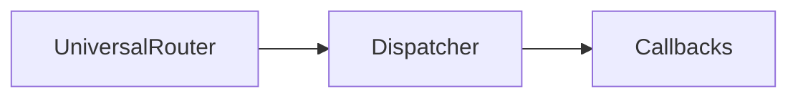

<watermark>
DRAFT
</watermark>

logo: SPEARBIT

# Uniswap v4 Universal Router Security Review

**Auditors**
Desmond Ho, Lead Security Researcher
Kurt Barry, Lead Security Researcher
Saw-Mon and Natalie, Lead Security Researcher
Jeiwan, Security Researcher
David Chaparro, Junior Security Researcher

**Report prepared by:** Lucas Goiriz

September 5, 2024

---

<watermark>
DRAFT
</watermark>

# Contents

**1 About Spearbit** **2**

**2 Introduction** **2**

**3 Risk classification** **2**
3.1 Impact **2**
3.2 Likelihood **2**
3.3 Action required for severity levels **2**

**4 Executive Summary** **3**

**5 Findings** **4**
5.1 Medium Risk **4**
5.1.1 `UniversalRouter` doesn't support incoming native token transfers from `poolManager` **4**
5.2 Informational **4**
5.2.1 `Callbacks` contract can be removed **4**
5.2.2 Comment Improvements **5**
5.2.3 Missing NatSpec comments affect readability **5**
5.2.4 Unused code should be removed **5**
5.2.5 Use `abi.encodeCall` whenever possible **6**

1


---

<watermark>
DRAFT
</watermark>

## 1 About Spearbit

Spearbit is a decentralized network of expert security engineers offering reviews and other security related services to Web3 projects with the goal of creating a stronger ecosystem. Our network has experience on every part of the blockchain technology stack, including but not limited to protocol design, smart contracts and the Solidity compiler. Spearbit brings in untapped security talent by enabling expert freelance auditors seeking flexibility to work on interesting projects together.

Learn more about us at [spearbit.com](https://spearbit.com)

## 2 Introduction

Uniswap is an open source decentralized exchange that facilitates automated transactions between ERC20 token tokens on various EVM-based chains through the use of liquidity pools and automatic market makers (AMM).

*Disclaimer: This security review does not guarantee against a hack. It is a snapshot in time of universal-router according to the specific commit. Any modifications to the code will require a new security review.*

## 3 Risk classification

| Severity level         | Impact: High | Impact: Medium | Impact: Low |
| ---------------------- | ------------ | -------------- | ----------- |
| **Likelihood: high**   | Critical     | High           | Medium      |
| **Likelihood: medium** | High         | Medium         | Low         |
| **Likelihood: low**    | Medium       | Low            | Low         |


### 3.1 Impact

*   High - leads to a loss of a significant portion (>10%) of assets in the protocol, or significant harm to a majority of users.
*   Medium - global losses <10% or losses to only a subset of users, but still unacceptable.
*   Low - losses will be annoying but bearable--applies to things like griefing attacks that can be easily repaired or even gas inefficiencies.

### 3.2 Likelihood

*   High - almost certain to happen, easy to perform, or not easy but highly incentivized
*   Medium - only conditionally possible or incentivized, but still relatively likely
*   Low - requires stars to align, or little-to-no incentive

### 3.3 Action required for severity levels

*   Critical - Must fix as soon as possible (if already deployed)
*   High - Must fix (before deployment if not already deployed)
*   Medium - Should fix
*   Low - Could fix

2


---

<watermark>
DRAFT
</watermark>

# 4 Executive Summary

**Disclaimer:** *The current report is a **draft**. Fix review is still in progress for many issues and nothing in this report should be considered finalized.*

Over the course of 30 days in total, [Uniswap](https://uniswap.org/) engaged with [Spearbit](https://spearbit.com) to review the [universal-router](https://github.com/Uniswap/universal-router) protocol. In this period of time a total of **6** issues were found.

### Summary

| Project Name        | Uniswap                                                                                                         |
| ------------------- | --------------------------------------------------------------------------------------------------------------- |
| Repository          | \[universal-router]\(https\://github.com/Uniswap/universal-router)                                              |
| Commit              | \[4ce107...cadef4]\(https\://github.com/Uniswap/universal-router/tree/4ce107d6387558b97816293fe2c0d4d7c4cadef4) |
| Type of Project     | DeFi, AMM                                                                                                       |
| Audit Timeline      | Jul 15 to Aug 26                                                                                                |
| Two week fix period | Aug 26 - Sep 10                                                                                                 |


### Issues Found

<table>
  <thead>
    <tr>
        <th>Severity</th>
        <th>Count</th>
        <th>Fixed</th>
        <th>Acknowledged</th>
    </tr>
  </thead>
  <tbody>
    <tr>
        <td>Critical Risk</td>
<td>0</td>
<td>0</td>
<td>0</td>
    </tr>
<tr>
        <td>High Risk</td>
<td>0</td>
<td>0</td>
<td>0</td>
    </tr>
<tr>
        <td>Medium Risk</td>
<td>1</td>
<td>1</td>
<td>0</td>
    </tr>
<tr>
        <td>Low Risk</td>
<td>0</td>
<td>0</td>
<td>0</td>
    </tr>
<tr>
        <td>Gas Optimizations</td>
<td>0</td>
<td>0</td>
<td>0</td>
    </tr>
<tr>
        <td>Informational</td>
<td>5</td>
<td>2</td>
<td>0</td>
    </tr>
<tr>
        <td><strong>Total</strong></td>
<td><strong>6</strong></td>
<td><strong>3</strong></td>
<td><strong>0</strong></td>
    </tr>
  </tbody>
</table>

3


---

<watermark>DRAFT</watermark>

# 5 Findings

## 5.1 Medium Risk

### 5.1.1 `UniversalRouter` doesn't support incoming native token transfers from `poolManager`

**Severity:** Medium Risk
**Context:** [UniversalRouter.sol#L68-L70](https://github.com/Uniswap/universal-router/blob/4ce107d6387558b97816293fe2c0d4d7c4cadef4/contracts/UniversalRouter.sol#L68-L70)
**Description:** One notable change in UniV4 core is the built-in compatibility for native tokens. As such, the universal router should be able to accept native token transfers from the `PoolManager` singleton contract, but the `receive()` function only allow calls from the `WETH9` contract, causing this functionality to break.
**Recommendation:** Also allow `poolManager` to call `receive()` function.
**Uniswap:** Fixed in [PR 376](https://github.com/Uniswap/universal-router/pull/376).
**Spearbit:** Fixed.

## 5.2 Informational

### 5.2.1 `Callbacks` contract can be removed

**Severity:** Informational
**Context:** [Callbacks.sol#L10](https://github.com/Uniswap/universal-router/blob/4ce107d6387558b97816293fe2c0d4d7c4cadef4/contracts/base/Callbacks.sol#L10), [Dispatcher.sol#L11](https://github.com/Uniswap/universal-router/blob/4ce107d6387558b97816293fe2c0d4d7c4cadef4/contracts/base/Dispatcher.sol#L11), [Dispatcher.sol#L21](https://github.com/Uniswap/universal-router/blob/4ce107d6387558b97816293fe2c0d4d7c4cadef4/contracts/base/Dispatcher.sol#L21)
**Description:** The `Callbacks` contract currently only has one end-point `supportsInterface` which only supports the `ERC165` interface and so basically it is the most minimal implementation of that interface. Previously this endpoint used to support more interfaces such as `ERC721`, ... and their corresponding callbacks were also included in this contract which were consequently got removed in [PR 346](https://github.com/Uniswap/universal-router/pull/346).

`Callbacks` is inherited by the `Dispatcher` contract which is inherited by the `UniversalRouter`:



**Recommendation:** If the `Callback` contract is not going be used for things such as:

* Backward compatibility for integrators.

It should probably be removed from the codebase to keep the structure clean.
**Uniswap:** Fixed in [PR 389](https://github.com/Uniswap/universal-router/pull/389).
**Spearbit:** Verified.

4


---

<watermark>DRAFT</watermark>

### 5.2.2 Comment Improvements

**Severity:** Informational

**Context:** Dispatcher.sol#L258-L259, Commands.sol#L56

**Description:** The following are comment clarifications for correctness, clarity and typos.

**Recommendation:**

![code diff: 
- // should only call modifyLiquidities() to mint or increase liquidity
- // do not permit or approve this contract over a v4 position or someone could use this command to
  // decrease/burn your position
+ // should only call modifyLiquidities() to mint
+ // do not permit or approve this contract over a v4 position or someone could use this command to
  // decrease, burn or transfer your position

- // COMMAND_PLACEHOLDER for 0x23 to 0x3f (all unused)
+ // COMMAND_PLACEHOLDER for 0x22 to 0x3f (all unused)](image)

**Uniswap:** Fixed in PR 392 and PR 387.

**Spearbit:** Verified.

### 5.2.3 Missing NatSpec comments affect readability

**Severity:** Informational

**Context:** Permit2Payments.sol#L64-L66

**Description:** Proper NatSpec documentation is crucial for code readability, maintainability, and for generating clear and comprehensive external documentation.

* `Permit2Payments.sol` is missing the `@param` description for the `owner` parameter.

**Recommendation:** Add the missing `@param` description for the `owner` parameter in the NatSpec comment:

![code diff:
  /// @notice Performs a batch transferFrom on Permit2
+ /// @param owner The owner of the tokens to be transferred
  /// @param batchDetails An array detailing each of the transfers that should occur
  function permit2TransferFrom(address owner, BatchTransferDetails[] calldata batchDetails) internal {
      // ... function implementation ...
  }](image)

**Uniswap:** Fixed in PR 392.

### 5.2.4 Unused code should be removed

**Severity:** Informational

**Context:** Payments.sol#L14, PaymentsImmutables.sol#L19-L22

**Description:** Unused code should be removed, this would help decreasing cognitive load and make easier the read, additionally reducing a little the contract codesize. Some instances:

* `InvalidSpender()` is an error defined in `Payments.sol` but unused.
* `enum Spenders` is an enum defined in `PaymentsImmutables.sol` but unused.

**Recommendation:** Remove unused code.

**Uniswap:** Fixed in PR 391.

**Spearbit:** Verified.

5


---

<watermark>
DRAFT
</watermark>

### 5.2.5 Use `abi.encodeCall` whenever possible

**Severity:** Informational

**Context:** [Dispatcher.sol#L271](https://github.com/Uniswap/universal-router/blob/4ce107d6387558b97816293fe2c0d4d7c4cadef4/contracts/base/Dispatcher.sol#L271)

**Description:** In this context, `encodeWithSelector` is used.

**Recommendation:** Use `encodeCall` to make sure that there are no typos and the also the correct types are used:

```solidity
(address(this)).call(abi.encodeCall(Dispatcher.execute, (_commands, _inputs)));
```

**Uniswap:** Fixed in PR 382.

**Spearbit:** Verified.

6
