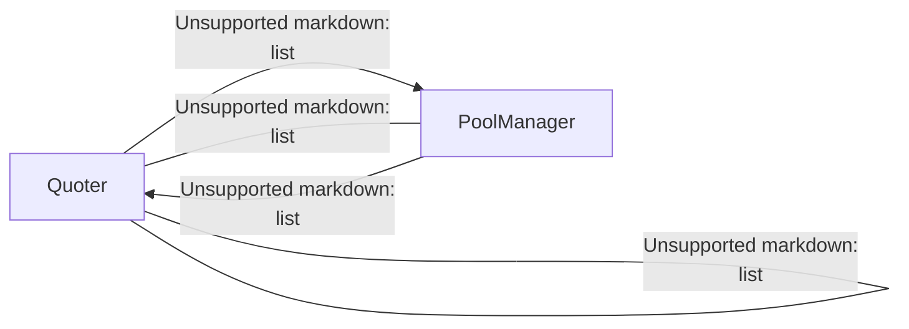

<watermark>
DRAFT
</watermark>

logo: SPEARBIT

# Uniswap v4-periphery Security Review

**Auditors**
Desmond Ho, Lead Security Researcher
Kurt Barry, Lead Security Researcher
Saw-Mon and Natalie, Lead Security Researcher
Jeiwan, Security Researcher
David Chaparro, Junior Security Researcher

**Report prepared by:** Lucas Goiriz

September 5, 2024

---

<watermark>
DRAFT
</watermark>

# Contents

**1 About Spearbit** **2**

**2 Introduction** **2**

**3 Risk classification** **2**
3.1 Impact . . . . . . . . . . . . . . . . . . . . . . . . . . . . . . . . . . . . . . . . . . . . . . . . . . . . . 2
3.2 Likelihood . . . . . . . . . . . . . . . . . . . . . . . . . . . . . . . . . . . . . . . . . . . . . . . . . . 2
3.3 Action required for severity levels . . . . . . . . . . . . . . . . . . . . . . . . . . . . . . . . . . . . . 2

**4 Executive Summary** **3**

**5 Findings** **4**
5.1 Medium Risk . . . . . . . . . . . . . . . . . . . . . . . . . . . . . . . . . . . . . . . . . . . . . . . 4
5.1.1 Positions may remain subscribed after burning . . . . . . . . . . . . . . . . . . . . . . . . 4
5.1.2 Incorrect tick compression for negative ticks in `countInitializedTicksLoaded` . . . . . . 4
5.1.3 Malicious users may cause unsubscription notifications to fail while successfully unsubscribing 6
5.1.4 Unsafe casting in `Quoter._swap` when comparing the exact output amounts . . . . . . . . 7
5.2 Low Risk . . . . . . . . . . . . . . . . . . . . . . . . . . . . . . . . . . . . . . . . . . . . . . . . . 11
5.2.1 Violations of Checks-Effects-Interactions pattern . . . . . . . . . . . . . . . . . . . . . . 11
5.2.2 Unsafe casting and overflow of negation . . . . . . . . . . . . . . . . . . . . . . . . . . . 11
5.2.3 Incorrect calldata consistency checks in `CalldataDecoder.decodeActionsRouterParams()` . 13
5.2.4 `Notifier.hasSubscriber()` should revert for non-existent tokens . . . . . . . . . . . . . 13
5.2.5 Inconsistent presence of slippage checks across various `settle` and `take` options . . . . 14
5.2.6 `multicall` will revert when ether is sent to unpayable functions . . . . . . . . . . . . . . 14
5.2.7 `subscribe` allows multiple subscriptions and will work for addresses with no code . . . . 15
5.2.8 `Notifier._call` does not check whether the target has a code . . . . . . . . . . . . . . . 16
5.3 Gas Optimization . . . . . . . . . . . . . . . . . . . . . . . . . . . . . . . . . . . . . . . . . . . . 16
5.3.1 "No Self-Permit" Checks Are Unnecessary . . . . . . . . . . . . . . . . . . . . . . . . . . 16
5.3.2 `countInitializedTicksLoaded` can be optimised to only cache `tickLowerInitialized` . . . 16
5.3.3 Cleaning up memory in `toId` can be optimized and is not tested . . . . . . . . . . . . . 18
5.3.4 `key.toId()` calculation can be cached in `countInitializedTicksLoaded` . . . . . . . . . . 19
5.3.5 Operations in `countOneBits` can be `unchecked` . . . . . . . . . . . . . . . . . . . . . . 21
5.3.6 `reason` is unnecessarily reassigned to the same value . . . . . . . . . . . . . . . . . . . 22
5.3.7 Avoid `SLOAD`s by caching state variables into local variables for gas savings . . . . . . . 22
5.3.8 `_ownerOf` storage parameter can be used directly in `ERC721Permit_v4.permit` . . . . . 23
5.3.9 `QuoteCache.prevAmount` is not required to quote the multi hop swaps . . . . . . . . . . 24
5.3.10 Deleting `amountOutCached` in `quoteExactOutputSingle` is redundant . . . . . . . . . . 26
5.4 Informational . . . . . . . . . . . . . . . . . . . . . . . . . . . . . . . . . . . . . . . . . . . . . . 29
5.4.1 Some contracts don't follow Uniswap's version convention . . . . . . . . . . . . . . . . . 29
5.4.2 Support for memory `config` parameter in `PositionConfigLibrary.toId()` . . . . . . . . . 30
5.4.3 `_swapExactOutput...` does not compare the `params.amountOut` to `ActionConstants.OPEN_DELTA` . . . . . . . . . . . . . . . . . . . . . . . . . . . . . . . . . . . . . . . . . . . 30
5.4.4 The use of `_mapRecipient` is inconsistent . . . . . . . . . . . . . . . . . . . . . . . . . . 30
5.4.5 Unnecessary fee subtraction during token minting . . . . . . . . . . . . . . . . . . . . . 31
5.4.6 `ERC721PermitHashLibrary` does not perform bit cleaning on variables with less than full word width in inline assembly . . . . . . . . . . . . . . . . . . . . . . . . . . . . . . . . . . . . 32
5.4.7 Swap flow reverts must not exceed `MINIMUM_VALID_RESPONSE_LENGTH` . . . . . . . . . . 32
5.4.8 Gas limit considerations across chains . . . . . . . . . . . . . . . . . . . . . . . . . . . . 32
5.4.9 Memory cleansing is not performed consistently . . . . . . . . . . . . . . . . . . . . . . 33
5.4.10 Unused code should be removed . . . . . . . . . . . . . . . . . . . . . . . . . . . . . . . 33
5.4.11 Missing NatSpec comments affect readability . . . . . . . . . . . . . . . . . . . . . . . . 34
5.4.12 Assembly blocks can be defined with the new memory-safe syntax . . . . . . . . . . . . 34
5.4.13 Unnecesary override keywords . . . . . . . . . . . . . . . . . . . . . . . . . . . . . . . . 34
5.4.14 Events missing indexed parameters difficult off-chain monitoring . . . . . . . . . . . . . 35
5.4.15 Comment Improvements . . . . . . . . . . . . . . . . . . . . . . . . . . . . . . . . . . . . 35

1

---

<watermark>
DRAFT
</watermark>

5.4.16 `UnsupportedAction` can be take out of the loops 35
5.4.17 Use `_positionConfigs(...)` instead of `positionConfigs[...]` to refactor the potential future logic 39
5.4.18 Use `abi.encodeCall` instead of `abi.encodeWithSelector` 39
5.4.19 `MINIMUM_VALID_RESPONSE_LENGTH` can be a greater number 40

2


---

<watermark>
DRAFT
</watermark>

## 1 About Spearbit

Spearbit is a decentralized network of expert security engineers offering reviews and other security related services to Web3 projects with the goal of creating a stronger ecosystem. Our network has experience on every part of the blockchain technology stack, including but not limited to protocol design, smart contracts and the Solidity compiler. Spearbit brings in untapped security talent by enabling expert freelance auditors seeking flexibility to work on interesting projects together.

Learn more about us at [spearbit.com](https://spearbit.com)

## 2 Introduction

Uniswap is an open source decentralized exchange that facilitates automated transactions between ERC20 token tokens on various EVM-based chains through the use of liquidity pools and automatic market makers (AMM).

*Disclaimer: This security review does not guarantee against a hack. It is a snapshot in time of v4-periphery according to the specific commit. Any modifications to the code will require a new security review.*

## 3 Risk classification

| Severity level         | Impact: High | Impact: Medium | Impact: Low |
| ---------------------- | ------------ | -------------- | ----------- |
| **Likelihood: high**   | Critical     | High           | Medium      |
| **Likelihood: medium** | High         | Medium         | Low         |
| **Likelihood: low**    | Medium       | Low            | Low         |


### 3.1 Impact

*   High - leads to a loss of a significant portion (>10%) of assets in the protocol, or significant harm to a majority of users.
*   Medium - global losses <10% or losses to only a subset of users, but still unacceptable.
*   Low - losses will be annoying but bearable--applies to things like griefing attacks that can be easily repaired or even gas inefficiencies.

### 3.2 Likelihood

*   High - almost certain to happen, easy to perform, or not easy but highly incentivized
*   Medium - only conditionally possible or incentivized, but still relatively likely
*   Low - requires stars to align, or little-to-no incentive

### 3.3 Action required for severity levels

*   Critical - Must fix as soon as possible (if already deployed)
*   High - Must fix (before deployment if not already deployed)
*   Medium - Should fix
*   Low - Could fix

3


---

<watermark>
DRAFT
</watermark>

## 4 Executive Summary

**Disclaimer:** *The current report is a **draft**. Fix review is still in progress for many issues and nothing in this report should be considered finalized.*

Over the course of 10 days in total, Uniswap engaged with Spearbit to review the v4-periphery protocol. In this period of time a total of **41** issues were found.

### Summary

| Project Name        | Uniswap                                                                                                     |
| ------------------- | ----------------------------------------------------------------------------------------------------------- |
| Repository          | v4-periphery                                                                                                |
| Commit              | \[469f85...04e484]\(https\://github.com/Uniswap/v4-periphery/tree/469f8562ac5ed74de0bb4db43479e50f1d04e484) |
| Type of Project     | DeFi, AMM                                                                                                   |
| Audit Timeline      | Jul 15 to Aug 26                                                                                            |
| Two week fix period | Aug 26 - Sep 10                                                                                             |


### Issues Found

<table>
  <thead>
    <tr>
        <th>Severity</th>
        <th>Count</th>
        <th>Fixed</th>
        <th>Acknowledged</th>
    </tr>
  </thead>
  <tbody>
    <tr>
        <td>Critical Risk</td>
<td>0</td>
<td>0</td>
<td>0</td>
    </tr>
<tr>
        <td>High Risk</td>
<td>0</td>
<td>0</td>
<td>0</td>
    </tr>
<tr>
        <td>Medium Risk</td>
<td>4</td>
<td>2</td>
<td>2</td>
    </tr>
<tr>
        <td>Low Risk</td>
<td>8</td>
<td>1</td>
<td>0</td>
    </tr>
<tr>
        <td>Gas Optimizations</td>
<td>10</td>
<td>1</td>
<td>8</td>
    </tr>
<tr>
        <td>Informational</td>
<td>19</td>
<td>10</td>
<td>3</td>
    </tr>
<tr>
        <td><strong>Total</strong></td>
<td><strong>41</strong></td>
<td><strong>14</strong></td>
<td><strong>13</strong></td>
    </tr>
  </tbody>
</table>

4


---

<watermark>
<u>DRAFT</u>
</watermark>

# 5 Findings

## 5.1 Medium Risk

### 5.1.1 Positions may remain subscribed after burning

**Severity:** Medium Risk

**Context:** [PositionManager.sol#L252-L272](https://github.com/Uniswap/v4-periphery/blob/469f8562ac5ed74de0bb4db43479e50f1d04e484/src/PositionManager.sol#L252-L272)

**Description:** `_unsubscribe()` isn't called when a liquidity position is burnt. While it triggers `_notifyModifyLiquidity()`, subscription services cannot distinguish decreasing liquidity to zero without burning versus burning.

It may pose a problem for positions to remain subscribed at the end of the position's lifecycle. At the very least, it would be something that subscription services need to be aware of.

**Recommendation:** Consider unsubscribing the position upon burning.

**Uniswap:**

* Unsubscribe on Burn: [PR 314](https://github.com/Uniswap/v4-periphery/pull/314).
* Adhering to CEI: [PR 333](https://github.com/Uniswap/v4-periphery/pull/333).

**Spearbit:** Fixed.

### 5.1.2 Incorrect tick compression for negative ticks in `countInitializedTicksLoaded`

**Severity:** Medium Risk

**Context:** [PoolTicksCounter.sol#L35-L39](https://github.com/Uniswap/v4-periphery/blob/469f8562ac5ed74de0bb4db43479e50f1d04e484/src/libraries/PoolTicksCounter.sol#L35-L39)

**Description:** The tick compression used in this context is:

```solidity
tick / key.tickSpacing
```

$$ \text{sgn}(i) \left\lfloor \left| \frac{i}{\Delta i} \right| \right\rfloor $$

which rounds towards 0. Although this compression is correct for non-negative values of tick $i$, for negative values that are not on tick boundaries, it is off by 1. The correct compression of a tick is calculated as:

```solidity
function compress(int24 tick, int24 tickSpacing) internal pure returns (int24 compressed) {
    // compressed = tick / tickSpacing;
    // if (tick < 0 && tick % tickSpacing != 0) compressed--;
    assembly ("memory-safe") {
        tick := signextend(2, tick)
        tickSpacing := signextend(2, tickSpacing)
        compressed :=
            sub(
                sdiv(tick, tickSpacing),
                // if (tick < 0 && tick % tickSpacing != 0) then tick % tickSpacing < 0, vice versa
                slt(smod(tick, tickSpacing), 0)
            )
    }
}
```

or in other words:

$$ \text{compress}(i, \Delta i) = \left\lfloor \frac{i}{\Delta i} \right\rfloor $$

and thus it rounds towards negative infinity ($-\infty$).

5


---

<watermark>
<u>DRAFT</u>
</watermark>

**Recommendation:** Make sure to use the correct compression as suggested above.

![code snippet: diff --git a/src/libraries/PoolTicksCounter.sol b/src/libraries/PoolTicksCounter.sol
index 7420ffd..e2a66f6 100644
--- a/src/libraries/PoolTicksCounter.sol
+++ b/src/libraries/PoolTicksCounter.sol
@@ -5,10 +5,12 @@ import {IPoolManager} from "@uniswap/v4-core/src/interfaces/IPoolManager.sol";
 import {PoolKey} from "@uniswap/v4-core/src/types/PoolKey.sol";
 import {PoolId, PoolIdLibrary} from "@uniswap/v4-core/src/types/PoolId.sol";
 import {StateLibrary} from "@uniswap/v4-core/src/libraries/StateLibrary.sol";
+import {TickBitmap} from "@uniswap/v4-core/src/libraries/TickBitmap.sol";

 library PoolTicksCounter {
     using PoolIdLibrary for PoolKey;
     using StateLibrary for IPoolManager;
+    using TickBitmap for int24;

     struct TickCache {
         int16 wordPosLower;
@@ -32,11 +34,13 @@ library PoolTicksCounter {

         {
             // Get the key and offset in the tick bitmap of the active tick before and after the swap.
-            int16 wordPos = int16((tickBefore / key.tickSpacing) >> 8);
-            uint8 bitPos = uint8(uint24((tickBefore / key.tickSpacing) % 256));
+            (int16 wordPos, uint8 bitPos) = tickBefore
+                .compress(key.tickSpacing)
+                .position();

-            int16 wordPosAfter = int16((tickAfter / key.tickSpacing) >> 8);
-            uint8 bitPosAfter = uint8(uint24((tickAfter / key.tickSpacing) % 256));
+            (int16 wordPosAfter, uint8 bitPosAfter) = tickAfter
+                .compress(key.tickSpacing)
+                .position();

             // In the case where tickAfter is initialized, we only want to count it if we are swapping
             downwards.
             // If the initializable tick after the swap is initialized, our original tickAfter is a](image)

**Warning:** The same issue is also present in v3-periphery repo. An also related issues can be noticed even in the docs:


should be:


Since in Javascript, `Math.floor` already rounds towards negative infinity.

**Uniswap:** Acknowledged. For various reasons we are now going to be re-architecting our Quoter contract. As this issue is related to the quoter, we will not be fixing it. However we will keep it in mind when writing our new Quoter contract.

6


---

<watermark>
<u>DRAFT</u>
</watermark>

Spearbit: Acknowledged.

### 5.1.3 Malicious users may cause unsubscription notifications to fail while successfully unsubscribing

**Severity**: Medium Risk

**Context**: [Notifier.sol#L74](https://github.com/Uniswap/v4-periphery/blob/469f8562ac5ed74de0bb4db43479e50f1d04e484/src/base/Notifier.sol#L74)

**Description**: The `subscriberGasLimit` isn't necessarily respected if a user passes a smaller gas limit to the function. Combined with the gas forwarding rule, it is possible for malicious users to pass just enough gas to cause a failing unsubscribe notification, while successfully unsubscribing.

**Proof of concept**: Apply the following patch:

```bash
git apply patched_file.patch
```

```solidity
diff --git a/test/position-managers/PositionManager.notifier.t.sol
    b/test/position-managers/PositionManager.notifier.t.sol
index 28f5813..5c7cc28 100644
--- a/test/position-managers/PositionManager.notifier.t.sol
+++ b/test/position-managers/PositionManager.notifier.t.sol
@@ -229,6 +229,26 @@ contract PositionManagerNotifierTest is Test, PosmTestSetup, GasSnapshot {
         assertEq(address(lpm.subscriber(tokenId)), address(0));
     }

+    function test_unsubscribe_succeeds_with_little_gas() public {
+        uint256 tokenId = lpm.nextTokenId();
+        mint(config, 100e18, alice, ZERO_BYTES);
+
+        // approve this contract to operate on alices liq
+        vm.startPrank(alice);
+        lpm.approve(address(this), tokenId);
+        vm.stopPrank();
+        lpm.subscribe(tokenId, config, address(sub), ZERO_BYTES);
+        uint256 beforeUnsubCount = sub.notifyUnsubscribeCount();
+        bytes memory pseudoData = hex"1234567890abcdef";
+        // increase pseudoData to raise gas storage cost
+        for (uint i; i < 10; ++i) {
+            pseudoData = bytes.concat(pseudoData, pseudoData);
+        }
+        // unsubscribe was successful, but notification reverted
+        lpm.unsubscribe{gas: 166_500}(tokenId, config, pseudoData);
+        assertEq(sub.notifyUnsubscribeCount(), beforeUnsubCount);
+    }
+
     function test_unsubscribe_isSuccessfulWithBadSubscriber() public {
         uint256 tokenId = lpm.nextTokenId();
         mint(config, 100e18, alice, ZERO_BYTES);
```

and run:

```bash
forge t -vvv --mt test_unsubscribe_succeeds_with_little_gas
```

**Recommendation**: Do a similar check as the one in fetching the protocol fee in `v4-core`:

```solidity
// to account for EIP-150, condition could be 64 * gasleft() / 63 <= subscriberGasLimit
if (gasleft() < subscriberGasLimit) InsufficientGas.selector.revertWith();
```

**Uniswap**: Fixed in [PR 318](https://github.com/Uniswap/v4-periphery/pull/318).

**Spearbit**: Fixed.

7


---

<watermark>
<u>DRAFT</u>
</watermark>

### 5.1.4 Unsafe casting in `Quoter._swap` when comparing the exact output amounts

**Severity:** Medium Risk

**Context:** [Quoter.sol#L318](https://github.com/Uniswap/v4-periphery/blob/469f8562ac5ed74de0bb4db43479e50f1d04e484/src/lens/Quoter.sol#L318)

**Description:** In this context we have:

```solidity
if (amountOutCached != 0 && amountOutCached != uint128(zeroForOne ? deltas.amount1() :
    deltas.amount0())) {
    revert InsufficientAmountOut();
}
```

When `amountOutCached` is non-zero it means we are swapping with exact output in this context when:

* `zeroForOne == true`, `deltas.amount1()` which equals to the amount out minus the specified before swap delta from the hook.
* `zeroForOne == false`, `deltas.amount0()` which equals to the amount out minus the specified before swap delta from the hook.

**Reference:**

* [Pool.sol#L441-L453](https://github.com/Uniswap/v4-core/blob/7a72031574fc4548ca8fce197114cf87d5a2c037/src/libraries/Pool.sol#L441-L453)
* [Pool.sol#L363-L374](https://github.com/Uniswap/v4-core/blob/7a72031574fc4548ca8fce197114cf87d5a2c037/src/libraries/Pool.sol#L363-L374)

In the `beforeSwap` hook and if `BEFORE_SWAP_RETURNS_DELTA_FLAG` is enabled and in the context of exact outputs, we have:

$$ a_{spec} + \Delta_{hook,before}^{spec} \ge \sum_{out} \ge 0 $$

But due to potential insufficient liquidity in the range specified by the user (unlimited by the `params.sqrtPriceLimitX96` since in this scenario it should be 0 which later gets converted.) the value of `swapDelta`'s output amount might be negative (`deltas.amountX()`):

$$ \sum_{out} - \Delta_{hook,before}^{spec} $$

| parameter                                    | description                                                              | type                    |
| -------------------------------------------- | ------------------------------------------------------------------------ | ----------------------- |
| $\Delta\_{hook,before}^{spec}$               | \`hookDeltaSpecified\`                                                   | \`int128\`              |
| $a\_{spec}$                                  | \`params.amountSpecified\`, \`amountOutCached\`                          | \`int256\`, \`uint128\` |
| $\sum\_{out}$                                | \`(params.amountSpecified - state.amountSpecifiedRemaining).toInt128()\` | \`int128\`              |
| $\sum\_{out} - \Delta\_{hook,before}^{spec}$ |                                                                          | \`int128\`              |


Then in this case if $\sum_{out} - \Delta_{hook,before}^{spec}$ and $a_{spec}$ are complementary with respect to 2<sup>128</sup> then the `revert` statement would be skipped:

$$ a_{spec} + \Delta_{hook,before}^{spec} - \sum_{out} $$

= 2<sup>128</sup>

or in other words:

8


---

<watermark>
DRAFT
</watermark>

$$ a_{\text{spec}} = 2^{128} + \sum_{\text{out}} - \Delta_{\text{hook,before}}^{\text{spec}} $$

Although one would have wanted to enforce the following:

$$ a_{\text{spec}} + \Delta_{\text{hook,before}}^{\text{spec}} = \sum_{\text{out}} $$

or

$$ a_{\text{spec}} = \sum_{\text{out}} - \Delta_{\text{hook,before}}^{\text{spec}} $$

That means we would have wanted to have the amount specified by the user to be equal to the exact output amount by the swaps minus the specified delta provided by the before swap hook.

More references:

* [Hooks.sol#L309](https://github.com/Uniswap/v4-core/blob/7a72031574fc4548ca8fce197114cf87d5a2c037/src/libraries/Hooks.sol#L309)
* [BalanceDelta.sol#L34-L46](https://github.com/Uniswap/v4-core/blob/7a72031574fc4548ca8fce197114cf87d5a2c037/src/types/BalanceDelta.sol#L34-L46)

**Proof of concept: Apply the following patch:**

```bash
git apply patched_file.patch
```

```diff
diff --git a/test/Quoter.t.sol b/test/Quoter.t.sol
index b01d9c8..a9a2bf3 100644
--- a/test/Quoter.t.sol
+++ b/test/Quoter.t.sol
@@ -2,7 +2,7 @@
 
 pragma solidity ^0.8.20;
 
-import {Test} from "forge-std/Test.sol";
+import {Test, console2} from "forge-std/Test.sol";
 import {PathKey} from "../src/libraries/PathKey.sol";
 import {IQuoter} from "../src/interfaces/IQuoter.sol";
 import {Quoter} from "../src/lens/Quoter.sol";
@@ -23,6 +23,50 @@ import {StateLibrary} from "@uniswap/v4-core/src/libraries/StateLibrary.sol";
 // solmate
 import {MockERC20} from "solmate/src/test/utils/mocks/MockERC20.sol";
 
+
+import {BaseHook} from "../src/base/hooks/BaseHook.sol";
+import {Hooks} from "@uniswap/v4-core/src/libraries/Hooks.sol";
+import {BalanceDelta, BalanceDeltaLibrary} from "@uniswap/v4-core/src/types/BalanceDelta.sol";
+import {toBeforeSwapDelta, BeforeSwapDelta, BeforeSwapDeltaLibrary} from
+    "@uniswap/v4-core/src/types/BeforeSwapDelta.sol";
+
+contract MockHooks is BaseHook {
+    using SafeCast for *;
+    using PoolIdLibrary for PoolKey;
+    using StateLibrary for IPoolManager;
+    using Hooks for IHooks;
+
+    constructor(IPoolManager _manager) BaseHook(_manager) {}
+
+    function getHookPermissions() public pure override returns (Hooks.Permissions memory p) {
+
```

9


---

<watermark>
DRAFT
</watermark>

```solidity
+    }
+
+    function validateHookAddress(BaseHook _this) internal pure override {}
+
+    function beforeSwap(address, PoolKey calldata poolKey, IPoolManager.SwapParams calldata params,
+    bytes calldata)
+        external
+        override
+        returns (bytes4, BeforeSwapDelta, uint24)
+    {
+        // uint128 liquidity = poolManager.getLiquidity(poolKey.toId());
+        // int256 LMinusAmountSpecified = int256(uint256(liquidity)) - params.amountSpecified;
+        // int256 res = int256(2 ** 128) + LMinusAmountSpecified;
+        // console2.log("a_spec: %s", params.amountSpecified);
+        // console2.log("L: %s", liquidity);
+        // console2.log("L - a_spec: %s", LMinusAmountSpecified);
+        // console2.log("res: %s", res);
+        return (
+            IHooks.beforeSwap.selector,
+            toBeforeSwapDelta(
+                10**6,
+                0
+            ),
+            0 // overriden LP fee
+        );
+    }
+}
+
 contract QuoteTest is Test, Deployers {
     using SafeCast for *;
     using PoolIdLibrary for PoolKey;
@@ -79,6 +123,46 @@ contract QuoteTest is Test, Deployers {
         setupPoolMultiplePositions(key02);
     }

+    function testQuoter_quoteExactOutputSingle_0to1_sqrtPriceLimitIsZero() public {
+        address hookAddr = address(uint160(Hooks.BEFORE_SWAP_FLAG |
+    Hooks.BEFORE_SWAP_RETURNS_DELTA_FLAG));
+
+        MockHooks impl = new MockHooks(IPoolManager(manager));
+        vm.etch(hookAddr, address(impl).code);
+        MockHooks mockHooks = MockHooks(hookAddr);
+
+        vm.label(hookAddr, "Hook");
+
+        PoolKey memory poolKey = createPoolKey(token0, token1, hookAddr);
+
+        manager.initialize(poolKey, SQRT_PRICE_1_1, ZERO_BYTES);
+        MockERC20(Currency.unwrap(poolKey.currency0)).approve(address(positionManager),
+    type(uint256).max);
+        MockERC20(Currency.unwrap(poolKey.currency1)).approve(address(positionManager),
+    type(uint256).max);
+        positionManager.modifyLiquidity(
+            poolKey,
+            IPoolManager.ModifyLiquidityParams(
+                MIN_TICK,
+                MAX_TICK,
+                calculateLiquidityFromAmounts(SQRT_PRICE_1_1, MIN_TICK, MAX_TICK, 10**6,
+    10**6).toInt256(),
+                0
+            ),
+        ),
```

10


---

<watermark>
DRAFT
</watermark>

```solidity
+           ZERO_BYTES
+       );
+
+       (int128[] memory deltaAmounts, uint160 sqrtPriceX96After, uint32 initializedTicksLoaded) =
+   quoter
+           .quoteExactOutputSingle(
+               IQuoter.QuoteExactSingleParams({
+                   poolKey: poolKey,
+                   zeroForOne: true,
+                   exactAmount: uint128(uint256(2**128 + 999988 - 10**6)),
+                   sqrtPriceLimitX96: 0,
+                   hookData: ZERO_BYTES
+               })
+           );
+
+       assertEq(deltaAmounts[0], 18453516209681194614061387);
+       assertEq(deltaAmounts[1], 12);
+   }
+
    function testQuoter_quoteExactInputSingle_ZeroForOne_MultiplePositions() public {
        uint256 amountIn = 10000;
        uint256 expectedAmountOut = 9871;
```

and run:

```bash
forge t -vvv --mt testQuoter_quoteExactOutputSingle_0to1_sqrtPriceLimitIsZero
```

In this test case we can see that:

$$ a_{\text{spec}} = 2^{128} - 12 $$

$$ \sum_{\text{out}} -\Delta_{\text{hook,before}}^{\text{spec}} = 999988 - 10^{6} = -12 $$

and as the result the test passes and the `InsufficientAmountOut()` gets skipped, even though exact output amount specified is $2^{128} - 12$ but the actual output amount of the swap after subtracting the before swap hook delta amount is $-12$.

**Recommendation:** Make sure the casting of `zeroForOne ? deltas.amount1() : deltas.amount0()` to `uint128` is safe (if this value is negative to also revert).

**Uniswap:** Acknowledged. For various reasons we are now going to be re-architecting our Quoter contract. As this issue is related to the quoter, we will not be fixing it. However we will keep it in mind when writing our new Quoter contract.

**Spearbit:** Acknowledged.

11


---

<watermark>
DRAFT
</watermark>

## 5.2 Low Risk

### 5.2.1 Violations of Checks-Effects-Interactions pattern

**Severity:** Low Risk

**Context:** PositionManager.sol#L246, PositionManager.sol#L269-L271, Notifier.sol#L76

**Description:** There are multiple violations of the Checks Effects Interactions pattern that are not protected from reentrancy:

1. In the `PositionManager._mint()` function, position config is saved after the `beforeModifyLiquidity` and `afterModifyLiquidity` hooks are called in the nested `PoolManager.modifyLiquidity()` call. There can be scenarios when hooks need to fetch the position config ID of a newly minted token via the `PositionManager.getPositionConfigId()` function. However, they won't be able to do so since the ID is saved after the hooks are called.

2. In the `PositionManager._burn()` function, token and its config ID are removed after the `beforeModifyLiquidity` and `afterModifyLiquidity` hooks are called and after the subscriber is notified. One way this can be exploited is, for example, by transferring a token in the `ISubscriber.notifyModifyLiquidity()` call—the token will be transferred to a different address and burned from that address; position's liquidity will be 0, however, since the subscriber is notified after liquidity was removed.

3. In the `Notifier.unsubscribe()` function, the subscriber is removed after the `notifyUnsubscribe()` call.

**Recommendation:**

1. In the `PositionManager._mint()` function, consider saving the position config ID right after minting the token and before invoking `_modifyLiquidity()`.

2. In the `PositionManager._burn()` function, consider deleting the position config ID and burning token at the beginning of the function, before `_modifyLiquidity()` is invoked.

3. In the `Notifier.unsubscribe()` function, consider deleting the subscriber address before making the `ISubscriber.notifyUnsubscribe()` call.

**Uniswap:**

* Notifier CEI fixed in [PR 303](https://github.com/Uniswap/v4-periphery/pull/303).
* `_mint` / `_burn` CEI has been suggested in [PR 310](https://github.com/Uniswap/v4-periphery/pull/310).

### 5.2.2 Unsafe casting and overflow of negation

**Severity:** Low Risk

**Context:** V4Router.sol#L89, V4Router.sol#L123, PositionManager.sol#L348, DeltaResolver.sol#L59, SlippageCheck.sol#L42, SlippageCheck.sol#L43, Quoter.sol#L176, Quoter.sol#L187, Quoter.sol#L207, Quoter.sol#L258, Quoter.sol#L253-L254, Quoter.sol#L182-L183, Quoter.sol#L214-L215, Quoter.sol#L288-L289, PositionManager.sol#L295, V4Router.sol#L108, V4Router.sol#L120-L126, V4Router.sol#L144

**Description/Recommendation:**

* [ ] **V4Router.sol#L89**: unsafe casting from `uint128` → `int128`. potentially changes an exact input swap to output swap and vice versa.
  Safer way of casting and negation would have been:
  1. `-int256(uint256(amountIn))` (just like in `_swapExactInput`) or maybe...
  2. we would want to revert if `amountIn` is greater than `type(int128).max`.
* [ ] **V4Router.sol#L123**: Unsafe cast `uint128` → `int128`.
  One can perform a safe cast of `int256(uint256(params.amountOut))` (just like in `_swapExactOutput`) but maybe it might be best to revert if `params.amountOut` is greater than `type(int128).max`.

12


---

<watermark>
DRAFT
</watermark>

PositionManager.sol#L348: Regarding this cast `uint256` → `uint160`, currently `_pay` is only used in `_set-tle` which later calls `poolManager.settle()`. With the current **implementation** of `IPoolManager`, the paid amount gets converted using `paid.toInt128()`. So if the amount are **correlated**, one can deduce that this casting is safe.

DeltaResolver.sol#L59: The negation `-_amount` `int256` → `uint256` should be relatively safe since

1.  with the current implementation of `applyDelta` to manage to bring the delta down to `type(int256).min` which would trigger the negation overflow it would take 2<sup>128</sup> calls to this function which seems pretty infeasible.

2.  `_getFullDebt` is only used for settling and so when `poolManager.settle{...}()` is called the total supply of the current currency would need to be at least `-type(int256).min` 2<sup>255</sup> which is against the total supply assumption of the pools supported by Uniswap v4-core.

[ ] SlippageCheck.sol#L42,SlippageCheck.sol#L43: The negation of `delta.amountX()` can overflow and revert. It might be best to perform the following casting when comparing values:

```solidity
uint256(amountXMax) < uint256(-int256(delta.amountX()))
```

[ ] Quoter.sol#L176: `uint128` → `int128`,

1.  `params.exactAmount`: if `i == 0` this casting on the extreme case of values more than `type(int128).max` is unsafe.

2.  `cache.prevCurrency`: This casting should be safe since this value equals to `cache.curDeltas.amountX()` which should be positive unless the delta is altered by a pool with an after swap hook.

[ ] Quoter.sol#L187: unsafe `int128` → `uint128` unless one mentions that these quoting calculating are only for pools without after swap hook that could potential turn these deltas negative.

[ ] Quoter.sol#L207: unsafe `uint128` → `int128`. It would be safer to do the casting as:

```solidity
-int256(uint256(params.exactAmount))
```

[ ] Quoter.sol#L258:

1.  unsafe cast `int128` → `uint128` unless one mentions that these quoting calculating are only for pools without after swap hook that could potential turn these deltas negative.

2.  The negation of `int128` can overflow when the value is `type(int128).min`.

[ ] Quoter.sol#L253-L254, Quoter.sol#L182-L183, Quoter.sol#L214-L215, Quoter.sol#L288-L289: *TODO*

PositionManager.sol#L295: `-currencyDelta` can potentially overflow, but due to the same reasoning as V4Router.sol#L89 it should not be feasible.

V4Router.sol#L108: The casting here `uint128` → `uint256` → `int256` is safe. The negation should not overflow due due to the type of casting.

[ ] V4Router.sol#L120-L126, V4Router.sol#L144: The negation of the output of `_swap(...)` can overflow.

13


---

<watermark>
DRAFT
</watermark>

### 5.2.3 Incorrect calldata consistency checks in `CalldataDecoder.decodeActionsRouterParams()`

**Severity:** Low Risk

**Context:** [CalldataDecoder.sol#L18](https://github.com/Uniswap/v4-periphery/blob/469f8562ac5ed74de0bb4db43479e50f1d04e484/src/libraries/CalldataDecoder.sol#L18)

**Description:** The `CalldataDecoder.decodeActionsRouterParams()` function decodes the calldata by implementing the `abi.decode()` function in inline assembly code. The function checks the consistency of the ABI-encoded calldata, but does this incorrectly:

1.  When verifying the length of the data, the function assumes `params.length` is the length of the encoded params ([CalldataDecoder.sol#L33-L43](https://github.com/Uniswap/v4-periphery/blob/469f8562ac5ed74de0bb4db43479e50f1d04e484/src/libraries/CalldataDecoder.sol#L33-L43)):

    

    However, `params.length` is the number of elements in the `params` array.

2.  It doesn't ensure that the actions pointer points at data located before the params array ([CalldataDecoder.sol#L24-L27](https://github.com/Uniswap/v4-periphery/blob/469f8562ac5ed74de0bb4db43479e50f1d04e484/src/libraries/CalldataDecoder.sol#L24-L27)):

    

3.  It doesn't ensure the `add` and `sub` operations don't overflow.

**Recommendation:** Consider improving the data encoding correctness checks. Alternatively, consider using the `abi.decode()` function to simplify the code.

**Uniswap:** First draft of a fix is in [PR 316](https://github.com/Uniswap/v4-periphery/pull/316). Also pushed an update that:

*   Masks offsets and length with `0xffffffff` to prevent overflow. Any sane value would be within a uint32 - if someone is using a larger value they're doing something weird.
*   Checks that the elements of the array are encoded in order to enforce normal ABI encoding of bytes arrays.

### 5.2.4 `Notifier.hasSubscriber()` should revert for non-existent tokens

**Severity:** Low Risk

**Context:** [Notifier.sol#L120](https://github.com/Uniswap/v4-periphery/blob/469f8562ac5ed74de0bb4db43479e50f1d04e484/src/base/Notifier.sol#L120)

**Description:** When a non-existent or burned token ID is passed to the `Notifier.hasSubscriber()` function, it returns `false` since the subscriber flag is set to 0 in a non-existent position config. However, non-existent tokens cannot be subscribed or unsubscribed, thus any value returned by the function is a false positive.

**Recommendation:** In the `Notifier.hasSubscriber()` function, consider reverting when the passed token ID hasn't yet been minted or was burned.

14


---

<watermark>
DRAFT
</watermark>

### 5.2.5 Inconsistent presence of slippage checks across various `settle` and `take` options

**Severity:** Low Risk

**Context:** [V4Router.sol#L53-L75](https://github.com/Uniswap/v4-periphery/blob/469f8562ac5ed74de0bb4db43479e50f1d04e484/src/V4Router.sol#L53-L75)

**Description:** The `SETTLE_ALL` and `TAKE_ALL` actions have slippage checks against `_getFullDebt()` and `_getFullCredit()`. Other settle and take actions, like `SETTLE_TAKE_PAIR`, provide the same amount mapping to `_getFullDebt()` and `_getFullCredit()`, but they do not have these slippage checks.

It is thus inconsistent for the slippage checks to present in the `SETTLE_ALL` and `TAKE_ALL` actions but absent in the others.

**Recommendation:** Either add slippage checks when to other options when the `_getFullDebt()` and `_getFullCredit()` path is taken, or remove it from the `SETTLE_ALL` and `TAKE_ALL` actions for consistency.

### 5.2.6 `multicall` will revert when ether is sent to unpayable functions

**Severity:** Low Risk

**Context:** ERC721Permit_v4.sol, [PoolInitializer.sol#L9](https://github.com/Uniswap/v4-periphery/blob/469f8562ac5ed74de0bb4db43479e50f1d04e484/src/base/PoolInitializer.sol#L9), [PositionManager.sol#L353](https://github.com/Uniswap/v4-periphery/blob/469f8562ac5ed74de0bb4db43479e50f1d04e484/src/PositionManager.sol#L353)

**Description:** `PositionManager` is expected to be able to call it's own and inherited functions by using `multicall()`, for it, functions are set with the `payable` modifier, in order to not revert when ether is used within the call.

Some external functions in the `ERC721Permit_v4` contract (inherited by `PositionManager`) and related contracts are not marked as `payable`, which could potentially break multicall functionality when these functions are called in a batch that includes payable functions.

Specifically, the following functions are non-payable:

* `setApprovalForAll`, `approve` overriden functions from ERC721 at `ERC721Permit_v4`.
* `transferFrom` overriden at `PositionManager`.
* All the other functions from Solmate ERC721 such as `safeTransferFrom`.
* `PoolInitializer.initializePool`.

Additionally, `view` and `pure` functions are also non-payable by default.

When these non-payable functions are included in a multicall alongside payable functions, the transaction may revert due to the attempt to send Ether to a non-payable function.

**Recommendation:** Consider marking all external functions that might be used in a multicall as `payable` and document clearly which functions can and which cannot be used in a multicall.

**Uniswap:** We only added `payable` to `initializePool`. Solidity prevents us from overriding Solmate's ERC721 functions with `payable`, and we decided not to fork/copy it. We believe that behaviors such as "transfer ownership, retain permissions, and increase liquidity" are obscure and still available with separate transactions.

**Spearbit:** Partially fixed in PR 320.

15


---

<watermark>
<u>DRAFT</u>
</watermark>

### 5.2.7 `subscribe` allows multiple subscriptions and will work for addresses with no code

**Severity:** Low Risk

**Context:** [Notifier.sol#L38-L60](https://github.com/Uniswap/v4-periphery/blob/469f8562ac5ed74de0bb4db43479e50f1d04e484/src/base/Notifier.sol#L38-L60)

**Description:** `Notifier.subscribe()` allows multiple/unlimited subscriptions with `newSubscriber = address(0)`. This can lead to multiple `Subscribed` events being emitted without corresponding `Unsubscribed` events. Furthermore, the function does not check if the `newSubscriber` address contains code, allowing subscriptions to non-existent contracts.

Therefore, as the call resulted in a valid state, calls to `hasSubscriber()` will result in a true value being returned. This may lead to some unexpected behaviors if some code relies on `hasSubscriber` for these non-existent contract cases:

```solidity
function subscribe(uint256 tokenId, PositionConfig calldata config, address newSubscriber, bytes
    calldata data)
    external
    payable
    onlyIfApproved(msg.sender, tokenId)
    onlyValidConfig(tokenId, config)
{
    // will revert below if the user already has a subcriber
    _positionConfigs(tokenId).setSubscribe();
    ISubscriber _subscriber = subscriber[tokenId];

    if (_subscriber != NO_SUBSCRIBER) revert AlreadySubscribed(address(_subscriber)); //
    NO_SUBSCRIBER == address(0) // <<<
    subscriber[tokenId] = ISubscriber(newSubscriber);

    bool success = _call( // <<<
        address(newSubscriber), abi.encodeWithSelector(ISubscriber.notifySubscribe.selector, tokenId,
        config, data)
    ); //@audit no checks of code.length

    if (!success) {
        Wrap__SubscriptionReverted.selector.bubbleUpAndRevertWith(address(newSubscriber));
    }

    emit Subscribed(tokenId, address(newSubscriber));
}
```

**Recommendation:** Modify `_call` function to check if the target address contains code. For example:

```solidity
require(target.code.length > 0, "Target must be a contract");
```

**Uniswap:** Added a solidity check for code length on `_call` in [PR 318](https://github.com/Uniswap/v4-periphery/pull/318).

**Spearbit:** Verified.

16


---

### 5.2.8 Notifier._call does not check whether the target has a code

**Severity:** Low Risk

**Context:** Notifier.sol#L113-L117

**Description:** Notifier._call does not check whether the target has a code:

code block: function _call(address target, bytes memory encodedCall) internal returns (bool success) { assembly ("memory-safe") { success := call(gas(), target, 0, add(encodedCall, 0x20), mload(encodedCall), 0, 0) } }

If target does not have a code associated to it the above call always returns true which can be misleading.

**Recommendation:** It would be best to add a check in _call to make sure `extcodesize(target)` is non-zero.

**Uniswap:** Fixed in commit [dd948d29](https://github.com/Uniswap/v4-periphery/pull/318/commits/dd948d29df5e8249226a8c17f2bd0d79cfe74ba5).

**Spearbit:** Verified.

## 5.3 Gas Optimization

### 5.3.1 "No Self-Permit" Checks Are Unnecessary

**Severity:** Gas Optimization

**Context:** ERC721Permit_v4.sol#L32, ERC721Permit_v4.sol#L50

**Description:** The ERC721Permit_v4 logic prohibits users from permitting themselves on their own tokens. While there is no use case for doing so, there are also no apparent security consequences. Further, users can call approve/approveForAll on their own address, which accomplishes the same thing. The "no self-permit" checks are thus inconsistent and add gas costs for no meaningful benefit.

**Recommendation:** Consider removing these checks to decrease the gas costs of permit-based flows.

**Uniswap:** Fixed in [PR 321](https://github.com/Uniswap/v4-periphery/pull/321).

### 5.3.2 countInitializedTicksLoaded can be optimised to only cache tickLowerInitialized

**Severity:** Gas Optimization

**Context:** PoolTicksCounter.sol#L13-L95

**Description:** countInitializedTicksLoaded currently calculate and caches both tickAfterInitialized and tickBeforeInitialized although in reality one only needs to use only the one corresponding to the minimum of the compressed ticks of the tickBefore and tickAfter.

**Recommendation:** Apply the following patch:

code diff: diff --git a/src/libraries/PoolTicksCounter.sol b/src/libraries/PoolTicksCounter.sol index 7420ffd..717ca7c 100644 --- a/src/libraries/PoolTicksCounter.sol +++ b/src/libraries/PoolTicksCounter.sol @@ -15,8 +15,7 @@ library PoolTicksCounter { int16 wordPosHigher; uint8 bitPosLower; uint8 bitPosHigher; - bool tickBeforeInitialized; - bool tickAfterInitialized; + bool tickLowerInitialized; }

17

---

<watermark>DRAFT</watermark>

```solidity
    /// @dev This function counts the number of initialized ticks that would incur a gas cost between
~~→~~ tickBefore and tickAfter.
@@ -38,20 +37,6 @@ library PoolTicksCounter {
             int16 wordPosAfter = int16((tickAfter / key.tickSpacing) >> 8);
             uint8 bitPosAfter = uint8(uint24((tickAfter / key.tickSpacing) % 256));

~~-~~         // In the case where tickAfter is initialized, we only want to count it if we are swapping
~~→~~ downwards.
~~-~~         // If the initializable tick after the swap is initialized, our original tickAfter is a
~~-~~         // multiple of tick spacing, and we are swapping downwards we know that tickAfter is
~~→~~ initialized
~~-~~         // and we shouldn't count it.
~~-~~         uint256 bmAfter = self.getTickBitmap(key.toId(), wordPosAfter);
~~-~~         cache.tickAfterInitialized =
~~-~~             ((bmAfter & (1 << bitPosAfter)) > 0) && ((tickAfter % key.tickSpacing) == 0) &&
~~→~~ (tickBefore > tickAfter);
~~-~~
~~-~~         // In the case where tickBefore is initialized, we only want to count it if we are
~~→~~ swapping upwards.
~~-~~         // Use the same logic as above to decide whether we should count tickBefore or not.
~~-~~         uint256 bmBefore = self.getTickBitmap(key.toId(), wordPos);
~~-~~         cache.tickBeforeInitialized =
~~-~~             ((bmBefore & (1 << bitPos)) > 0) && ((tickBefore % key.tickSpacing) == 0) &&
~~→~~ (tickBefore < tickAfter);
~~-~~
             if (wordPos < wordPosAfter || (wordPos == wordPosAfter && bitPos <= bitPosAfter)) {
                 cache.wordPosLower = wordPos;
                 cache.bitPosLower = bitPos;
@@ -63,6 +48,12 @@ library PoolTicksCounter {
                 cache.wordPosHigher = wordPos;
                 cache.bitPosHigher = bitPos;
             }
<u>+</u>
<u>+</u>         int24 tickLower = tickBefore < tickAfter ? tickBefore : tickAfter;
<u>+</u>         uint256 bm = self.getTickBitmap(key.toId(), cache.wordPosLower);
<u>+</u>
<u>+</u>         cache.tickLowerInitialized =
<u>+</u>             ((bm & (1 << cache.bitPosLower)) > 0) && ((tickLower % key.tickSpacing) == 0);
         }

         // Count the number of initialized ticks crossed by iterating through the tick bitmap.
@@ -83,11 +74,7 @@ library PoolTicksCounter {
             mask = type(uint256).max;
         }

~~-~~     if (cache.tickAfterInitialized) {
~~-~~         initializedTicksLoaded -= 1;
~~-~~     }
~~-~~
~~-~~     if (cache.tickBeforeInitialized) {
<u>+</u>     if (cache.tickLowerInitialized && tickBefore != tickAfter) {
             initializedTicksLoaded -= 1;
         }
```

`forge s --diff`

18


---

<watermark>
DRAFT
</watermark>

```text
testQuoter_quoteExactOutput_0to2_0TickLoaded_startingInitialized() (gas: -1611 (-0.306%))
testQuoter_quoteExactInput_0to2_0TickLoaded_startingInitialized() (gas: -1611 (-0.318%))
testQuoter_quoteExactInput_2to0_0TickLoaded_startingInitialized() (gas: -1591 (-0.319%))
testQuoter_quoteExactOutput_0to2_2TicksLoaded() (gas: -1463 (-0.571%))
testQuoter_quoteExactOutput_2to0_2TicksLoaded() (gas: -1473 (-0.591%))
testQuoter_quoteExactInput_0to2_2TicksLoaded() (gas: -1463 (-0.618%))
testQuoter_quoteExactInput_2to0_2TicksLoaded() (gas: -1473 (-0.645%))
testQuoter_quoteExactOutput_0to2_1TickLoaded_initialiedAfter() (gas: -1460 (-0.647%))
testQuoter_quoteExactOutput_0to2_1TickLoaded() (gas: -1463 (-0.649%))
testQuoter_quoteExactOutput_2to0_2TicksLoaded_initialiedAfter() (gas: -1621 (-0.650%))
testQuoter_quoteExactInput_0to2_1TickLoaded_initialiedAfter() (gas: -1460 (-0.709%))
testQuoter_quoteExactInput_2to0_2TicksLoaded_initialiedAfter() (gas: -1621 (-0.710%))
testQuoter_quoteExactOutput_0to2_1TickLoaded() (gas: -1463 (-0.712%))
testQuoter_quoteExactInput_2to0_1TickLoaded() (gas: -1594 (-0.730%))
testQuoter_quoteExactOutput_0to2_0TickLoaded_startingNotInitialized() (gas: -1463 (-0.781%))
testQuoter_quoteExactOutput_0to2to1() (gas: -2938 (-0.796%))
testQuoter_quoteExactOutput_2to1() (gas: -1473 (-0.809%))
testQuoter_quoteExactInput_0to2_0TickLoaded_startingNotInitialized() (gas: -1463 (-0.876%))
testQuoter_quoteExactInputSingle_ZeroForOne_MultiplePositions() (gas: -1462 (-0.883%))
testQuoter_quoteExactInput_0to2to1() (gas: -2938 (-0.898%))
testQuoter_quoteExactInput_2to0_0TickLoaded_startingNotInitialized() (gas: -1473 (-0.916%))
testQuoter_quoteExactInput_2to1() (gas: -1473 (-0.917%))
testQuoter_quoteExactInputSingle_OneForZero_MultiplePositions() (gas: -1472 (-0.937%))
testQuoter_quoteExactOutputSingle_0to1() (gas: -1462 (-1.512%))
testQuoter_quoteExactOutputSingle_1to0() (gas: -1472 (-1.652%))
Overall gas change: -40456 (-0.023%)
```

**Uniswap**: For various reasons we are now going to be re-architecting our Quoter contract. As this issue is related to the quoter, we will not be fixing it. However we will keep it in mind when writing our new Quoter contract.

**Spearbit**: Acknowledged.

### 5.3.3 Cleaning up memory in `toId` can be optimized and is not tested

**Severity**: Gas Optimization

**Context**: PositionConfig.sol#L30-L32

**Description**: The memory cleaning implementation in `toId` function of `PositionConfigLibrary` can be optimized for gas efficiency. The function uses multiple `mstore` operations to clear memory, which can be replaced with a more efficient method such as `calldatacopy` or `codecopy`.

**Recommendation**: Replace the 3 `mstore` used for memory cleaning with `calldatacopy`:

```solidity
    function toId(PositionConfig calldata config) internal pure returns (bytes32 id) {
        assembly ("memory-safe") {
            // [...]

            id := shr(1, keccak256(add(fmp, 0x0c), 0x48))

            // now clean the memory we used
-           // mstore(add(fmp, 0x40), 0)
-           // mstore(add(fmp, 0x20), 0)
-           // mstore(fmp, 0)
+           calldatacopy(fmp, calldatasize(), 96) // Clean 96 bytes (3 * 32-byte words)
        }
    }
```

And add a test to `PositionConfig.t.sol` to verify that memory is indeed cleaned:

19


---

<watermark>
DRAFT
</watermark>

code block: function test_memoryCleaningAfterToId(PositionConfig calldata config) public { // Test the function bytes32 id = PositionConfigLibrary.toId(config); // Revert if memory after fmp is not zeroed assembly { let fmp := mload(0x40) for { let i := 0 } lt(i, 3) { i := add(i, 1) } { let value := mload(add(fmp, mul(i, 0x20))) if iszero(iszero(value)) { revert(0, 0) } } } }

**Uniswap:** `PositionConfig` is being removed in PR 310 in periphery so we are not fixing position-config related issues.

**Spearbit:** Acknowledged.

### 5.3.4 `key.toId()` calculation can be cached in `countInitializedTicksLoaded`

**Severity:** Gas Optimization

**Context:** [PoolTicksCounter.sol#L45](https://github.com/Uniswap/v4-periphery/blob/469f8562ac5ed74de0bb4db43479e50f1d04e484/src/libraries/PoolTicksCounter.sol#L45), [PoolTicksCounter.sol#L51](https://github.com/Uniswap/v4-periphery/blob/469f8562ac5ed74de0bb4db43479e50f1d04e484/src/libraries/PoolTicksCounter.sol#L51), [PoolTicksCounter.sol#L78](https://github.com/Uniswap/v4-periphery/blob/469f8562ac5ed74de0bb4db43479e50f1d04e484/src/libraries/PoolTicksCounter.sol#L78)

**Description:** `key.toId()` calculation which involves hashing a memory region can be cached in `countInitializedTicksLoaded`.

**Recommendation:** The following patch can be applied:

20


---

<watermark>
DRAFT
</watermark>

```diff
diff --git a/src/libraries/PoolTicksCounter.sol b/src/libraries/PoolTicksCounter.sol
index 7420ffd..bc3e52d 100644
--- a/src/libraries/PoolTicksCounter.sol
+++ b/src/libraries/PoolTicksCounter.sol
@@ -29,7 +29,7 @@ library PoolTicksCounter {
         returns (uint32 initializedTicksLoaded)
     {
         TickCache memory cache;
-
+        PoolId poolId = key.toId();
         {
             // Get the key and offset in the tick bitmap of the active tick before and after the swap.
             int16 wordPos = int16((tickBefore / key.tickSpacing) >> 8);
@@ -42,13 +42,13 @@ library PoolTicksCounter {
             // If the initializable tick after the swap is initialized, our original tickAfter is a
             // multiple of tick spacing, and we are swapping downwards we know that tickAfter is
             // initialized
-            uint256 bmAfter = self.getTickBitmap(key.toId(), wordPosAfter);
+            uint256 bmAfter = self.getTickBitmap(poolId, wordPosAfter);
             cache.tickAfterInitialized =
                 ((bmAfter & (1 << bitPosAfter)) > 0) && ((tickAfter % key.tickSpacing) == 0) &&
                 (tickBefore > tickAfter);

             // In the case where tickBefore is initialized, we only want to count it if we are
             // swapping upwards.
             // Use the same logic as above to decide whether we should count tickBefore or not.
-            uint256 bmBefore = self.getTickBitmap(key.toId(), wordPos);
+            uint256 bmBefore = self.getTickBitmap(poolId, wordPos);
             cache.tickBeforeInitialized =
                 ((bmBefore & (1 << bitPos)) > 0) && ((tickBefore % key.tickSpacing) == 0) &&
                 (tickBefore < tickAfter);

@@ -75,7 +75,7 @@ library PoolTicksCounter {
             mask = mask & (type(uint256).max >> (255 - cache.bitPosHigher));
         }

-        uint256 bmLower = self.getTickBitmap(key.toId(), cache.wordPosLower);
+        uint256 bmLower = self.getTickBitmap(poolId, cache.wordPosLower);
         uint256 masked = bmLower & mask;
         initializedTicksLoaded += countOneBits(masked);
         cache.wordPosLower++;
```

`forge s --diff`

21


---

<watermark>
<u>DRAFT</u>
</watermark>

```description
A code block showing gas change results for various testQuoter functions, with values like -175 (-0.033%) and an overall gas change of -5475 (-0.003%).
```

**Uniswap:** Acknowledged. For various reasons we are now going to be re-architecting our Quoter contract. As this issue is related to the quoter, we will not be fixing it. However we will keep it in mind when writing our new Quoter contract.

**Spearbit:** Acknowledged.

### 5.3.5 Operations in `countOneBits` can be `unchecked`

**Severity:** Gas Optimization

**Context:** [PoolTicksCounter.sol#L100-L101](https://github.com/Uniswap/v4-periphery/blob/469f8562ac5ed74de0bb4db43479e50f1d04e484/src/libraries/PoolTicksCounter.sol#L100-L101)

**Description:** There are mathematical operations in the `countOneBits` function that are done using checked arithmetic but are incapable of overflow or underflow by construction. Using an `unchecked` block would save gas without compromising safety.

*   Decreasing `x` should be safe due to the `x != 0` loop continuation condition.
*   Increasing `bits` should be safe as a `uint16` represents values of at most 65535 and the loop can execute at most 256 times.

**Recommendation:** Consider wrapping the function body in an `unchecked` block to save gas:

```solidity
function countOneBits(uint256 x) private pure returns (uint16) {
    uint16 bits = 0;
+   unchecked {
        while (x != 0) {
            bits++;
            x &= (x - 1);
        }
+   }
    return bits;
}
```

22


---

<watermark>
DRAFT
</watermark>

**Uniswap:** Acknowledged. For various reasons we are now going to be re-architecting our Quoter contract. As this issue is related to the quoter, we will not be fixing it. However we will keep it in mind when writing our new Quoter contract.

**Spearbit:** Acknowledged.

### 5.3.6 `reason` is unnecessarily reassigned to the same value

**Severity:** Gas Optimization

**Context:** [Quoter.sol#L124-L155](https://github.com/Uniswap/v4-periphery/blob/469f8562ac5ed74de0bb4db43479e50f1d04e484/src/Quoter.sol#L124-L155)

**Description:** In both `_handleRevertSingle` and `_handleRevert` functions, the `reason` parameter is unnecessarily reassigned to the result of `validateRevertReason(reason)`. This assignment is redundant because `validateRevertReason` either returns the same `reason` parameter or reverts if the length is less than the minimum required. This also generates a tiny gas optimization of -3 per call.

**Recommendation:** Remove the unnecessary reassignment.

```diff
- reason = validateRevertReason(reason);
+ validateRevertReason(reason);
```

**Uniswap:** Acknowledged. For various reasons we are now going to be re-architecting our Quoter contract. As this issue is related to the quoter, we will not be fixing it. However we will keep it in mind when writing our new Quoter contract.

**Spearbit:** Acknowledged.

### 5.3.7 Avoid `SLOAD`s by caching state variables into local variables for gas savings

**Severity:** Gas Optimization

**Context:** [Quoter.sol#L317-L319](https://github.com/Uniswap/v4-periphery/blob/469f8562ac5ed74de0bb4db43479e50f1d04e484/src/Quoter.sol#L317-L319)

**Description:** `amountOutCached` is a state variable that is accessed multiple times within a function. Caching this value in a local variable can save gas by reducing the number of storage reads.

**Recommendation:** Cache the value of `amountOutCached` state variable in a local variable `_amountOutCached` as it would reduce the number of storage reads:

```solidity
uint128 _amountOutCached = amountOutCached;
if (_amountOutCached != 0 && _amountOutCached // ...
```

**Uniswap:** Acknowledged. For various reasons we are now going to be re-architecting our Quoter contract. As this issue is related to the quoter, we will not be fixing it. However we will keep it in mind when writing our new Quoter contract.

**Spearbit:** Acknowledged.

23


---

<watermark>
DRAFT
</watermark>

### 5.3.8 `_ownerOf` storage parameter can be used directly in `ERC721Permit_v4.permit`

**Severity:** Gas Optimization

**Context:** `ERC721Permit_v4.sol#L31`

**Description:** The line in this context uses the function `ownerOf` from `solmate`'s `ERC721` implementation which is:

```solidity
function ownerOf(uint256 id) public view virtual returns (address owner) {
    require((owner = _ownerOf[id]) != address(0), "NOT_MINTED");
}
```

and thus it is checked whether the `tokenId` has a non-zero owner or not. Further down where the signature is verified by `signature.verify(_hashTypedData(digest), owner)` the `SignatureVerification` library also performs the same check:

```solidity
function verify(bytes calldata signature, bytes32 hash, address claimedSigner) internal view {
    bytes32 r;
    bytes32 s;
    uint8 v;

    if (claimedSigner.code.length == 0) { // <--- address(0) ends up in this if block
        if (signature.length == 65) {
            (r, s) = abi.decode(signature, (bytes32, bytes32));
            v = uint8(signature[64]);
        } else if (signature.length == 64) {
            // EIP-2098
            bytes32 vs;
            (r, vs) = abi.decode(signature, (bytes32, bytes32));
            s = vs & UPPER_BIT_MASK;
            v = uint8(uint256(vs >> 255)) + 27;
        } else {
            revert InvalidSignatureLength();
        }
        address signer = ecrecover(hash, v, r, s);
        if (signer == address(0)) revert InvalidSignature(); // <--- it is checked whether the signer /
        // the owner is a non-zero address
        if (signer != claimedSigner) revert InvalidSigner();
    } else {
        bytes4 magicValue = IERC1271(claimedSigner).isValidSignature(hash, signature);
        if (magicValue != IERC1271.isValidSignature.selector) revert InvalidContractSignature();
    }
}
```

and therefore the non-zero-ness of the owner is checked twice.

**Recommendation:** One can query the owner without checking whether it is `address(0)` or not:

```solidity
address owner = _ownerOf[tokenId];
// ...
// non-zero-ness of the `owner` is checked below during the signature verification
signature.verify(_hashTypedData(digest), owner);
```

```bash
forge s --diff
```

```text
test_permit_collect() (gas: -59 (-0.009%))
test_fuzz_decreaseLiquidity_native_withClose((int24,int24,int256,bytes32),uint256) (gas: -50 (-0.010%))
test_fuzz_decreaseLiquidity_native_withTakePair((int24,int24,int256,bytes32),uint256) (gas: -50
(-0.010%))
test_multicall_permitAndDecrease() (gas: -59 (-0.010%))
test_permit_increaseLiquidity() (gas: -59 (-0.011%))
test_fuzz_collect_sameRange_erc20((int24,int24,int256,bytes32),uint256) (gas: 109 (0.012%))
test_permit_thirdParty() (gas: -59 (-0.012%))
```

24


---

<watermark>
<u>DRAFT</u>
</watermark>

```text
test_permit_operatorSelfPermit() (gas: -59 (-0.012%))
test_permit_decreaseLiquidity() (gas: -59 (-0.012%))
test_gas_permit() (gas: -59 (-0.013%))
test_fuzz_burn_nonEmptyPosition((int24,int24,int256,bytes32)) (gas: -52 (-0.013%))
test_fuzz_collect_erc20((int24,int24,int256,bytes32)) (gas: -90 (-0.014%))
test_permit_notOwnerRevert() (gas: -59 (-0.015%))
test_fuzz_collect_native_withTakePair_addressRecipient((int24,int24,int256,bytes32)) (gas: -119
↳ (-0.017%))
test_fuzz_collect_native_withClose((int24,int24,int256,bytes32)) (gas: -119 (-0.019%))
test_fuzz_collect_native_withTakePair_msgSenderRecipient((int24,int24,int256,bytes32)) (gas: -119
↳ (-0.019%))
test_fuzz_collect_native_withTakePair((int24,int24,int256,bytes32)) (gas: -119 (-0.019%))
test_fuzz_burn_emptyPosition((int24,int24,int256,bytes32)) (gas: -76 (-0.019%))
test_gas_permit_secondPosition() (gas: -118 (-0.019%))
test_fuzz_decreaseLiquidity((int24,int24,int256,bytes32),uint256) (gas: 95 (0.021%))
test_fuzz_decreaseLiquidity_clear((int24,int24,int256,bytes32),uint256) (gas: 95 (0.021%))
test_fuzz_mint_clear_revert((int24,int24,int256,bytes32)) (gas: -71 (-0.021%))
test_fuzz_decreaseLiquidity_clearExceedsThenTake((int24,int24,int256,bytes32)) (gas: -103 (-0.024%))
test_fuzz_burn_native_emptyPosition_withClose((int24,int24,int256,bytes32)) (gas: -112 (-0.026%))
test_gas_permit_twice() (gas: -118 (-0.026%))
test_fuzz_burn_native_emptyPosition_withTakePair((int24,int24,int256,bytes32)) (gas: -113 (-0.026%))
test_fuzz_mint_native_excess_withSettlePair((int24,int24,int256,bytes32)) (gas: -118 (-0.027%))
test_fuzz_mint_native_excess_withClose((int24,int24,int256,bytes32)) (gas: -119 (-0.027%))
test_fuzz_burn_native_nonEmptyPosition_withClose((int24,int24,int256,bytes32)) (gas: -113 (-0.027%))
test_fuzz_burn_native_nonEmptyPosition_withTakePair((int24,int24,int256,bytes32)) (gas: -113 (-0.027%))
test_fuzz_mint_native((int24,int24,int256,bytes32)) (gas: -118 (-0.027%))
test_fuzz_increaseLiquidity_native_excess_withClose((int24,int24,int256,bytes32)) (gas: -153 (-0.029%))
test_fuzz_increaseLiquidity_native_excess_withSettlePair((int24,int24,int256,bytes32)) (gas: -153
↳ (-0.029%))
test_fuzz_mint_withLiquidityDelta((int24,int24,int256,bytes32),uint160) (gas: 133 (0.033%))
test_fuzz_increaseLiquidity_native((int24,int24,int256,bytes32)) (gas: -185 (-0.035%))
test_fuzz_erc721permit_caller(address,address) (gas: -59 (-0.038%))
test_fuzz_erc721permit_spender(address) (gas: -59 (-0.038%))
test_fuzz_decreaseLiquidity_assertCollectedBalance((int24,int24,int256,bytes32),uint256) (gas: 266
↳ (0.041%))
test_fuzz_erc721PermitForAll_permitNonceUsed(uint256) (gas: -59 (-0.043%))
test_fuzz_erc721permit_unauthorized() (gas: -59 (-0.053%))
test_fuzz_erc721PermitForAll_invalidSignatureForPermit(address) (gas: -59 (-0.056%))
test_fuzz_erc721permit_nonceAlreadyUsed_twoPositions() (gas: -118 (-0.075%))
test_fuzz_erc721permit_nonceAlreadyUsed() (gas: -118 (-0.090%))
Overall gas change: -2806 (-0.002%)
```

**Uniswap**: Fixed in commit [02185ec8](https://github.com/Uniswap/v4-periphery/pull/321/commits/02185ec8d806aec7148ddf55e3a9daf721ef4255#diff-593e190c7aa7e389499a4171c8787487b99cbba332315202d034a47f52900e54).

**Spearbit**: Verified.

### 5.3.9 `QuoteCache.prevAmount` is not required to quote the multi hop swaps

**Severity**: Gas Optimization

**Context**: [Quoter.sol#L40](https://github.com/Uniswap/v4-periphery/blob/469f8562ac5ed74de0bb4db43479e50f1d04e484/src/lens/Quoter.sol#L40), [Quoter.sol#L176](https://github.com/Uniswap/v4-periphery/blob/469f8562ac5ed74de0bb4db43479e50f1d04e484/src/lens/Quoter.sol#L176), [Quoter.sol#L187](https://github.com/Uniswap/v4-periphery/blob/469f8562ac5ed74de0bb4db43479e50f1d04e484/src/lens/Quoter.sol#L187), [Quoter.sol#L238](https://github.com/Uniswap/v4-periphery/blob/469f8562ac5ed74de0bb4db43479e50f1d04e484/src/lens/Quoter.sol#L238), [Quoter.sol#L258](https://github.com/Uniswap/v4-periphery/blob/469f8562ac5ed74de0bb4db43479e50f1d04e484/src/lens/Quoter.sol#L258)

**Description**: `QuoteCache.prevAmount` is not required to quote the multi hop swaps. Depending on the direction of the swap the required value to be used for the `_swap` (after applying the correct casting and negation) would either equal to:

* `cache.deltaOut` or...
* `cache.deltaIn`

* `_quoteExactInput`:

25

---

<watermark>
<u>DRAFT</u>
</watermark>

$$(C_{\text{exact}}, a_{\text{exact}}, \Delta_0, 0, 0) \rightarrow (C_{\text{inter}}^0, a_{\text{out}}^0, \Delta_1, \sqrt{P_0}, n_0) \rightarrow \dots$$

* `_quoteExactOutput`:

$$(C_{\text{exact}}, a_{\text{exact}}, \Delta_m, \sqrt{P_m}, n_m) \leftarrow (C_{\text{inter}}^{m-1}, a_{\text{in}}^{m-1}, \Delta_{m-1}, \sqrt{P_{m-1}}, n_{m-1}) \leftarrow \dots$$

**Recommendation: Apply the following patch:**

```diff
diff --git a/src/lens/Quoter.sol b/src/lens/Quoter.sol
index fcf63d0..988ff87 100644
--- a/src/lens/Quoter.sol
+++ b/src/lens/Quoter.sol
@@ -37,7 +37,6 @@ contract Quoter is IQuoter, SafeCallback {
 
     struct QuoteCache {
         BalanceDelta curDeltas;
-        uint128 prevAmount;
         int128 deltaIn;
         int128 deltaOut;
         int24 tickBefore;
@@ -173,7 +172,7 @@ contract Quoter is IQuoter, SafeCallback {
             (cache.curDeltas, cache.sqrtPriceX96After, cache.tickAfter) = _swap(
                 poolKey,
                 zeroForOne,
-                -int256(int128(i == 0 ? params.exactAmount : cache.prevAmount)),
+                (i == 0 ? -int256(int128(params.exactAmount)) : int256(cache.deltaOut)),
                 0,
                 params.path[i].hookData
             );
@@ -184,7 +183,6 @@ contract Quoter is IQuoter, SafeCallback {
             result.deltaAmounts[i] += cache.deltaIn;
             result.deltaAmounts[i + 1] += cache.deltaOut;
 
-            cache.prevAmount = zeroForOne ? uint128(cache.curDeltas.amount1()) :
-                uint128(cache.curDeltas.amount0());
             cache.prevCurrency = params.path[i].intermediateCurrency;
             result.sqrtPriceX96AfterList[i] = cache.sqrtPriceX96After;
             result.initializedTicksLoadedList[i] =
@@ -235,7 +233,7 @@ contract Quoter is IQuoter, SafeCallback {
         uint128 curAmountOut;
 
         for (uint256 i = pathLength; i > 0; i--) {
-            curAmountOut = i == pathLength ? params.exactAmount : cache.prevAmount;
+            curAmountOut = i == pathLength ? params.exactAmount : uint128(cache.deltaIn);
             curAmountOut = i == pathLength ? params.exactAmount : uint128(cache.deltaIn);
             amountOutCached = curAmountOut;
 
@@ -255,7 +253,6 @@ contract Quoter is IQuoter, SafeCallback {
             result.deltaAmounts[i - 1] += cache.deltaIn;
             result.deltaAmounts[i] += cache.deltaOut;
 
-            cache.prevAmount = !oneForZero ? uint128(-cache.curDeltas.amount0()) :
-                uint128(-cache.curDeltas.amount1());
             cache.prevCurrency = params.path[i - 1].intermediateCurrency;
             result.sqrtPriceX96AfterList[i - 1] = cache.sqrtPriceX96After;
             result.initializedTicksLoadedList[i - 1] =
```

**Uniswap: Acknowledged.** For various reasons we are now going to be re-architecting our Quoter contract. As this issue is related to the quoter, we will not be fixing it. However we will keep it in mind when writing our new Quoter contract.

26


---

<watermark>
DRAFT
</watermark>

Spearbit: Acknowledged.

### 5.3.10 Deleting `amountOutCached` in `quoteExactOutputSingle` is redundant

**Severity**: Gas Optimization

**Context**: [Quoter.sol#L92](https://github.com/Uniswap/v4-periphery/blob/469f8562ac5ed74de0bb4db43479e50f1d04e484/src/lens/Quoter.sol#L92), [Quoter.sol#L285](https://github.com/Uniswap/v4-periphery/blob/469f8562ac5ed74de0bb4db43479e50f1d04e484/src/lens/Quoter.sol#L285)

**Description**: The line in this context is redundant. Note that besides this line the storage parameter `amountOut-Cached` is used in the following pattern:

```solidity
function f(/*...*/) /*...*/ {
    // ...
    <CONDITION ?> amountOutCached = value;
    // ...
    (/*...*/) = _swap(/*...*/);
    delete amountOutCached; // or delete if non-zero
    // ...
}

function _swap(/*...*/) /*...*/ {
    if (
        amountOutCached != 0 &&
        amountOutCached != uint128(zeroForOne ? deltas.amount1() : deltas.amount0())
    ) {
        revert InsufficientAmountOut();
    }
}
```

1. Whenever `amountOutCached` has been assigned a value in the same function it has been cleared.
2. In `quoteExactOutputSingle`, the call `poolManager.unlock` always reverts. This also applies to:
    * `quoteExactInputSingle`
    * `quoteExactInput`
    * `quoteExactOutputSingle`
    * `quoteExactOutput`
    and so before and after the main call frame to `Quoter`, `amountOutCached` will always be 0.



27


---

<watermark>
DRAFT
</watermark>

**Recommendation:** Remove the link in this context:

code snippet: - if (params.sqrtPriceLimitX96 == 0) delete amountOutCached;

terminal output: forge s --diff testQuoter_quoteExactOutputSingle_0to1() (gas: -37 (-0.038%)) testQuoter_quoteExactOutputSingle_1to0() (gas: -37 (-0.042%)) Overall gas change: -74 (-0.000%)

One can also completely get rid of this storage variable by just adding a `bool` flag to the `_swap` function:

![git diff: diff --git a/src/lens/Quoter.sol b/src/lens/Quoter.sol
index fcf63d0..7429bf3 100644
--- a/src/lens/Quoter.sol
+++ b/src/lens/Quoter.sol
@@ -22,9 +22,6 @@ contract Quoter is IQuoter, SafeCallback {
     using PathKeyLib for PathKey;
     using StateLibrary for IPoolManager;

-    /// @dev cache used to check a safety condition in exact output swaps.
-    uint128 private amountOutCached;
-
     /// @dev min valid reason is 3-words long
     /// @dev int128[2] + sqrtPriceX96After padded to 32bytes + intializeTicksLoaded padded to 32bytes
     uint256 internal constant MINIMUM_VALID_RESPONSE_LENGTH = 96;
@@ -89,7 +86,6 @@ contract Quoter is IQuoter, SafeCallback {
         {
             try poolManager.unlock(abi.encodeWithSelector(this._quoteExactOutputSingle.selector, params))
             {}
             catch (bytes memory reason) {
-                if (params.sqrtPriceLimitX96 == 0) delete amountOutCached;
                 return _handleRevertSingle(reason);
             }
         }
@@ -175,7 +171,8 @@ contract Quoter is IQuoter, SafeCallback {
                     zeroForOne,
                     -int256(int128(i == 0 ? params.exactAmount : cache.prevAmount)),
                     0,
-                    params.path[i].hookData
+                    params.path[i].hookData,
+                    false
                 );

                 (cache.deltaIn, cache.deltaOut) = zeroForOne
@@ -206,7 +203,8 @@ contract Quoter is IQuoter, SafeCallback {
                 params.zeroForOne,
                 -int256(int128(params.exactAmount)),
                 params.sqrtPriceLimitX96,
-                params.hookData
+                params.hookData,
+                false
             );

             int128[] memory deltaAmounts = new int128;
@@ -236,7 +234,6 @@ contract Quoter is IQuoter, SafeCallback {
         for (uint256 i = pathLength; i > 0; i--) {
             curAmountOut = i == pathLength ? params.exactAmount : cache.prevAmount;
-            amountOutCached = curAmountOut;

             (PoolKey memory poolKey, bool oneForZero) = PathKeyLib.getPoolAndSwapDirection(](image)

28


---

<watermark>
DRAFT
</watermark>

```solidity
        params.path[i - 1], i == pathLength ? params.exactCurrency : cache.prevCurrency
@@ -245,10 +242,8 @@ contract Quoter is IQuoter, SafeCallback {
        (, cache.tickBefore,,) = poolManager.getSlot0(poolKey.toId());

        (cache.curDeltas, cache.sqrtPriceX96After, cache.tickAfter) =
            _swap(poolKey, !oneForZero, int256(uint256(curAmountOut)), 0, params.path[i -
-       1].hookData);
+       1].hookData, true);

        // always clear because sqrtPriceLimitX96 is set to 0 always
-       delete amountOutCached;
        (cache.deltaIn, cache.deltaOut) = !oneForZero
            ? (-cache.curDeltas.amount0(), -cache.curDeltas.amount1())
            : (-cache.curDeltas.amount1(), -cache.curDeltas.amount0());
@@ -270,19 +265,16 @@ contract Quoter is IQuoter, SafeCallback {

    /// @dev quote an ExactOutput swap on a pool, then revert with the result
    function _quoteExactOutputSingle(QuoteExactSingleParams calldata params) public selfOnly returns
    (bytes memory) {
        // if no price limit has been specified, cache the output amount for comparison in the swap
        callback
-       if (params.sqrtPriceLimitX96 == 0) amountOutCached = params.exactAmount;

        (, int24 tickBefore,,) = poolManager.getSlot0(params.poolKey.toId());
        (BalanceDelta deltas, uint160 sqrtPriceX96After, int24 tickAfter) = _swap(
            params.poolKey,
            params.zeroForOne,
            int256(uint256(params.exactAmount)),
            params.sqrtPriceLimitX96,
-           params.hookData
+           params.hookData,
+           params.sqrtPriceLimitX96 == 0
        );

-       if (amountOutCached != 0) delete amountOutCached;
        int128[] memory deltaAmounts = new int128;

        deltaAmounts[0] = -deltas.amount0();
@@ -303,7 +295,8 @@ contract Quoter is IQuoter, SafeCallback {
        bool zeroForOne,
        int256 amountSpecified,
        uint160 sqrtPriceLimitX96,
-       bytes calldata hookData
+       bytes calldata hookData,
+       bool shouldExactOutCheck
    ) private returns (BalanceDelta deltas, uint160 sqrtPriceX96After, int24 tickAfter) {
        deltas = poolManager.swap(
            poolKey,
@@ -315,7 +308,7 @@ contract Quoter is IQuoter, SafeCallback {
            hookData
        );
        // only exactOut case
-       if (amountOutCached != 0 && amountOutCached != uint128(zeroForOne ? deltas.amount1() :
-       deltas.amount0())) {
+       if (shouldExactOutCheck && amountSpecified != int256(zeroForOne ? deltas.amount1() :
+       deltas.amount0())) {
            revert InsufficientAmountOut();
        }
        (sqrtPriceX96After, tickAfter,,) = poolManager.getSlot0(poolKey.toId());
```

29


---

<watermark>
DRAFT
</watermark>

```
forge s --diff
```

```
testQuoter_quoteExactInput_0to2_0TickLoaded_startingInitialized() (gas: -2110 (-0.417%))
testQuoter_quoteExactInput_2to0_0TickLoaded_startingInitialized() (gas: -2110 (-0.423%))
testQuoter_quoteExactInput_0to2to1() (gas: -2220 (-0.679%))
testQuoter_quoteExactInput_0to2_2TicksLoaded() (gas: -2110 (-0.892%))
testQuoter_quoteExactInput_2to0_2TicksLoaded_initialiedAfter() (gas: -2110 (-0.924%))
testQuoter_quoteExactInput_2to0_2TicksLoaded() (gas: -2110 (-0.925%))
testQuoter_quoteExactInput_0to2_2TicksLoaded_initialiedAfter() (gas: -2110 (-1.025%))
testQuoter_quoteExactInput_0to2_1TickLoaded() (gas: -2110 (-1.027%))
testQuoter_quoteExactInput_0to2_0TickLoaded_startingNotInitialized() (gas: -2110 (-1.263%))
testQuoter_quoteExactInputSingle_ZeroForOne_MultiplePositions() (gas: -2141 (-1.294%))
testQuoter_quoteExactInput_2to0_0TickLoaded_startingNotInitialized() (gas: -2110 (-1.312%))
testQuoter_quoteExactInput_2to1() (gas: -2110 (-1.313%))
testQuoter_quoteExactInputSingle_OneForZero_MultiplePositions() (gas: -2141 (-1.362%))
testQuoter_quoteExactOutputSingle_0to1() (gas: -2335 (-2.415%))
testQuoter_quoteExactOutputSingle_1to0() (gas: -2335 (-2.621%))
testQuoter_quoteExactOutput_0to2_0TickLoaded_startingInitialized() (gas: -22559 (-4.286%))
testQuoter_quoteExactOutput_0to2_2TicksLoaded() (gas: -22559 (-8.799%))
testQuoter_quoteExactOutput_2to0_2TicksLoaded_initialiedAfter() (gas: -22559 (-9.043%))
testQuoter_quoteExactOutput_2to0_2TicksLoaded() (gas: -22559 (-9.048%))
testQuoter_quoteExactOutput_0to2_1TickLoaded_initialiedAfter() (gas: -22559 (-9.990%))
testQuoter_quoteExactOutput_0to2_1TickLoaded() (gas: -22559 (-10.006%))
testQuoter_quoteExactOutput_2to0_1TickLoaded() (gas: -22559 (-10.326%))
testQuoter_quoteExactOutput_0to2to1() (gas: -43118 (-11.681%))
testQuoter_quoteExactOutput_2to0_0TickLoaded_startingNotInitialized() (gas: -22559 (-12.049%))
testQuoter_quoteExactOutput_2to1() (gas: -22559 (-12.387%))
Overall gas change: -278421 (-0.159%)
```

**Uniswap**: Acknowledged. For various reasons we are now going to be re-architecting our Quoter contract. As this issue is related to the quoter, we will not be fixing it. However we will keep it in mind when writing our new Quoter contract.

**Spearbit**: Acknowledged.

## 5.4 Informational

### 5.4.1 Some contracts don't follow Uniswap's version convention

**Severity**: Informational

**Context**: V4Router.sol, IV4Router.sol, ActionConstants.sol, BipsLibrary.sol, Multicall_v4.sol, IMulticall_v4.sol, ImmutableState.sol, EIP712_v4.sol, IQuoter.sol, Quoter.sol, StateView.sol, PathKey.sol, IERC721Permit_v4.sol, IERC20PermitAllowed.sol

**Description**: The Solidity pragma statements in various contracts within the v4-periphery repository do not adhere to Uniswap's stated rules for version specification:

Uniswap's stated rules:

1. Contracts to be deployed should have a fixed compiler version for safety (0.8.26).
2. Open-source libraries without transient storage should use ^0.8.0.
3. Open-source libraries with transient storage should use ^0.8.24.

Current pragma statements that don't follow this::

* `^0.8.19`: V4Router, IV4Router, ActionConstants, BipsLibrary, Multicall_v4, IMulticall_v4, ImmutableState.
* `^0.8.20`: EIP712_v4, IQuoter, Quoter, StateView, PathKey.

30


---

<watermark>
DRAFT
</watermark>

* `>=0.7.5`: `IERC721Permit_v4`.
* `>=0.5.0`: `IERC20PermitAllowed`.

**Recommendation:** Standardize the version in order to align the codebase with Uniswap's stated best practices, locking the pragma version where posible or setting the correct range where needed.

**Uniswap:** Fixed in PR 332.

### 5.4.2 Support for `memory` `config` parameter in `PositionConfigLibrary.toId()`

**Severity:** Informational

**Context:** [PositionConfig.sol#L15](https://github.com/Uniswap/v4-periphery/blob/469f8562ac5ed74de0bb4db43479e50f1d04e484/src/libraries/PositionConfig.sol#L15)

**Description:** The current implementation only accepts the `PositionConfig` parameter as `calldata`. However, integrators may create the config structure within their contract, which would be stored in memory, and may want to calculate and store the ID on their end. While they can call `getPositionConfigId()` to fetch the ID, it would be more convenient if they could utilise the method directly.

**Recommendation:** Consider changing `calldata` to `memory`, or writing a duplicate function with `memory`.

**Uniswap:** Acknowledged. `PositionConfig` is being refactored (see [PR 310](https://github.com/Uniswap/v4-periphery/pull/310)) in periphery so we are not fixing position-config related issues.

**Spearbit:** Acknowledged.

### 5.4.3 `_swapExactOutput...` does not compare the `params.amountOut` to `ActionConstants.OPEN_DELTA`

**Severity:** Informational

**Context:** [V4Router.sol#L123](https://github.com/Uniswap/v4-periphery/blob/469f8562ac5ed74de0bb4db43479e50f1d04e484/src/V4Router.sol#L123), [V4Router.sol#L136](https://github.com/Uniswap/v4-periphery/blob/469f8562ac5ed74de0bb4db43479e50f1d04e484/src/V4Router.sol#L136)

**Description:** Unlike `_swapExactInput...` where the initial amount is compared to `ActionConstants.OPEN_DELTA` to instead use `_getFullCredit(c).toUint128()`, in `_swapExactOutput...` one does follow the same pattern to use `_getFullDebt(c).toUint128()`.

**Recommendation:** It might be useful to check whether `params.amountOut` equals to `ActionConstants.OPEN_DELTA` and if it does instead use the `_getFullDebt(c).toUint128()` as the starting `amountOut`.

### 5.4.4 The use of `_mapRecipient` is inconsistent

**Severity:** Informational

**Context:** [PositionManager.sol#L282](https://github.com/Uniswap/v4-periphery/blob/469f8562ac5ed74de0bb4db43479e50f1d04e484/src/PositionManager.sol#L282)

**Description:** `_mapRecipient` has been used directly inside `_takePair` whereas all the other uses of `_mapRecipient` are in the `_handleAction` `if`/`else` blocks. So most of the internal utility functions take their input arguments already mapped.

**Recommendation:** To keep the code consistent it would make sense to also apply the mapping to the input of `_takePair` in `_handleAction`:

31


---

<watermark>
DRAFT
</watermark>

```
diff --git a/src/PositionManager.sol b/src/PositionManager.sol
index 2f4c9bd..cb20fb3 100644
--- a/src/PositionManager.sol
+++ b/src/PositionManager.sol
@@ -168,7 +168,7 @@ contract PositionManager is
             _settlePair(currency0, currency1);
         } else if (action == Actions.TAKE_PAIR) {
             (Currency currency0, Currency currency1, address to) =
-        params.decodeCurrencyPairAndAddress();
-            _takePair(currency0, currency1, to);
+        params.decodeCurrencyPairAndAddress();
+            _takePair(currency0, currency1, _mapRecipient(to));
         } else if (action == Actions.SETTLE) {
             (Currency currency, uint256 amount, bool payerIsUser) =
-        params.decodeCurrencyUint256AndBool();
-            _settle(currency, _mapPayer(payerIsUser), _mapSettleAmount(amount, currency));
@@ -279,9 +279,8 @@ contract PositionManager is
     }

     function _takePair(Currency currency0, Currency currency1, address to) internal {
-        address recipient = _mapRecipient(to);
-        _take(currency0, recipient, _getFullCredit(currency0));
-        _take(currency1, recipient, _getFullCredit(currency1));
+        _take(currency0, to, _getFullCredit(currency0));
+        _take(currency1, to, _getFullCredit(currency1));
     }

     function _close(Currency currency) internal {
```

**Uniswap:** Fixed in [PR 334](https://github.com/Uniswap/v4-periphery/pull/334).

**Spearbit:** Verified.

### 5.4.5 Unnecessary fee subtraction during token minting

**Severity:** Informational

**Context:** [PositionManager.sol#L245](https://github.com/Uniswap/v4-periphery/blob/469f8562ac5ed74de0bb4db43479e50f1d04e484/src/PositionManager.sol#L245)

**Description:** In the `PositionManager._mint()` function, the fee amount (`feesAccrued`) returned from the `_modifyLiquidity()` function invocation is copied to memory and later subtracted from the liquidity delta (`liquidityDelta`). However, new positions never have accrued fees, thus handling them is not necessary.

**Recommendation:** In the `PositionManager._mint()` function, consider ignoring the accrued fee returned from `_modifyLiquidity()`.

**Uniswap:** Fixed in [PR 321](https://github.com/Uniswap/v4-periphery/pull/321).

**Spearbit:** Verified.

32


---

<watermark>
DRAFT
</watermark>

### 5.4.6 `ERC721PermitHashLibrary` does not perform bit cleaning on variables with less than full word width in inline assembly

**Severity:** Informational

**Context:** ERC721PermitHash.sol#L20, ECR721PermitHash.sol#L37-L38

**Description:** In the `ERC721PermitHashLibrary` library, function arguments with less than full word width are used in inline assembly without cleaning the unused upper bits of the raw word values. While this poses no risk in the reviewed code because in actual usage these arguments are always directly calldata arguments (which `solc` does perform bit cleaning on), these internal library functions may be used in other contexts where this does not hold true. In such a case, incorrect hashes can be computed and this could lead to unexpected transaction failures or other negative consequences.

**Recommendation:** Preferably, clean the upper bits of the relevant values to ensure that the library is safe for use in arbitrary contexts. Alternatively, document the assumption that the input data has no dirty bits via a comment in the code (any developer documentation concerning this library should also mention this assumption).

**Uniswap:** Fix in v4-periphery's PR 324.

**Spearbit:** Fix verified.

### 5.4.7 Swap flow reverts must not exceed `MINIMUM_VALID_RESPONSE_LENGTH`

**Severity:** Informational

**Context:** Quoter.sol#L124-L130, PoolManager.sol#L191-L249, Pool.sol#L283-L454

**Description:** It is very important that any reverts arising from the quote and swap flow do not exceed the `MINIMUM_VALID_RESPONSE_LENGTH`. Otherwise, the decoded info in the main call frame can be misinterpreted. Right now this does not happen for most of the reasons, where they will revert with the `UnexpectedRevertBytes()` reason.

However, 1 exception is the `beforeSwap` and `afterSwap` hooks, as they can return arbitrary data (and thus length). Nevertheless, hook reverts are wrapped with `Wrap__FailedHookCall`, which has selector `0x319d54c3`, and therefore *should* be an invalid offset when decoding, resulting in a generic `EvmError` revert.

**Recommendation:** Any changes to the revert reasons for the quote / swap flow has to be checked to not exceed `MINIMUM_VALID_RESPONSE_LENGTH`. Also, consider handling the exception for the `Wrap__FailedHookCall` case to bubble up the revert reason.

**Uniswap:** Acknowledged. For various reasons we are now going to be re-architecting our Quoter contract. As this issue is related to the quoter, we will not be fixing it. However we will keep it in mind when writing our new Quoter contract.

**Spearbit:** Acknowledged.

### 5.4.8 Gas limit considerations across chains

**Severity:** Informational

**Context:** Notifier.sol#L25-L28

**Description:** Different chains have different block gas limits. The more popular ones like Mainnet, Base, Arbitrum, Optimism and Polygon use 30 million, but there are some outliers like BSC (140M), iota EVM (1B) and Zksync (~2^32 = 4.2B).

Also note that block gas limits may not be static. For instance, mainnet gas limits have increased over the years, but `BLOCK_LIMIT_BPS` is immutable.

**Recommendation:** The block gas limit would have to be considered when deploying to a new chain, while also factoring in possible changes to the current value.

**Uniswap:** We decided to move back to a fixed-limit instead of percentage-based.

**Spearbit:** Fixed.

33


---

<watermark>
DRAFT
</watermark>

### 5.4.9 Memory cleansing is not performed consistently

**Severity:** Informational

**Context:** ERC721PermitHash.sol#L11-L43, EIP712_v4.sol#L40-L49

**Description:** In `hashPermit`, `hashPermitForAll`, and `_hashTypedData` functions, memory is allocated and used for calculations, but not cleaned up after. This differs from the approach used in `PositionConfigLibrary.toId`:

```solidity
function toId(PositionConfig calldata config) internal pure returns (bytes32 id) {
    // calculations
    // ...

    // now clean the memory we used
    mstore(add(fmp, 0x40), 0)
    mstore(add(fmp, 0x20), 0)
    mstore(fmp, 0)
}
```

Where memory is cleaned up post-calculation. While not cleaning up memory can save gas, it may lead to potential issues.

**Recommendation:** If not cleaning up the memory from the slot pointed by the free memory pointer onwards, then in later calculations involving memory, one should take into consideration that the memory region to be used might not be clean. Otherwise, consider cleaning memory after all uses and/or document why it is safe not to do it.

**Uniswap:** Addressed in PR 325.

### 5.4.10 Unused code should be removed

**Severity:** Informational

**Context:** IQuoter.sol#L14-L15, PoolTicksCounter.sol#L6, Actions.sol#L19, Actions.sol#L38-L39, IV4Router.sol#L5, PoolTicksCounter.sol#L94

**Description:** Unused code should be removed, this would help decreasing cognitive load and improve readability, additionally it reduces the contract codesize a little. Some instances are:

*   In `IQuoter`, the error `InvalidQuoteBatchParams()` is declared but unused.
*   In `PoolTickCounters`, the `PoolId` named import is unused and can be removed (however, if the gas optimization of caching the `key.toId()` computation is implemented, it must be kept).
*   In `Actions`, the constants `DONATE`, `MINT_6909`, `BURN_6909` are unused.
*   In `IV4Router`, the `CurrencyLibrary` import is unused.
*   In `PoolTicksCounter`, the return statement in `countInitializedTicksLoaded` is redundant as `initializedTicksLoaded` is already the named return variable, and thus the explicit `return` can be removed.

**Recommendation:** Consider removing the unused errors, imports, constants, etc...

**Uniswap:** Unused imports are removed in PR 306.

34


---

<watermark>DRAFT</watermark>

### 5.4.11 Missing NatSpec comments affect readability

**Severity:** Informational

**Context:** [IERC721Permit_v4.sol#L15-L17](https://github.com/Uniswap/v4-periphery/blob/469f8562ac5ed74de0bb4db43479e50f1d04e484/src/interfaces/IERC721Permit_v4.sol#L15-L17), [IERC721Permit_v4.sol#L25-L28](https://github.com/Uniswap/v4-periphery/blob/469f8562ac5ed74de0bb4db43479e50f1d04e484/src/interfaces/IERC721Permit_v4.sol#L25-L28)

**Description:** Proper NatSpec documentation is crucial for code readability, maintainability, and for generating clear and comprehensive external documentation.

* `IERC721Permit_v4.sol` is missing the `@param` description for the `nonce` parameter in the `permit()` and `permitForAll()` functions.

**Recommendation:** Add the missing `@param` description for the `nonce` parameter.

**Uniswap:** Fixed in [PR 335](https://github.com/Uniswap/v4-periphery/pull/335).

**Spearbit:** Fixed.

### 5.4.12 Assembly blocks can be defined with the new memory-safe syntax

**Severity:** Informational

**Context:** [BaseHook.sol#L48-L49](https://github.com/Uniswap/v4-periphery/blob/469f8562ac5ed74de0bb4db43479e50f1d04e484/src/base/hooks/BaseHook.sol#L48-L49), [Quoter.sol#L118-L119](https://github.com/Uniswap/v4-periphery/blob/469f8562ac5ed74de0bb4db43479e50f1d04e484/src/lens/Quoter.sol#L118-L119)

**Description:** Some assembly block uses an older syntax for indicating memory-safe assembly. Updating to the new syntax would improve consistency with current Solidity best practices.

**Recommendation:** Update the assembly syntax to use the inline memory-safe declaration:


**Uniswap:** Fixed in [PR 321](https://github.com/Uniswap/v4-periphery/pull/321).

**Spearbit:** Verified.

### 5.4.13 Unnecesary override keywords

**Severity:** Informational

**Context:** [EIP712_v4.sol#L30](https://github.com/Uniswap/v4-periphery/blob/469f8562ac5ed74de0bb4db43479e50f1d04e484/src/base/EIP712_v4.sol#L30), [Multicall_v4.sol#L10](https://github.com/Uniswap/v4-periphery/blob/469f8562ac5ed74de0bb4db43479e50f1d04e484/src/base/Multicall_v4.sol#L10), [Quoter.sol#L60](https://github.com/Uniswap/v4-periphery/blob/469f8562ac5ed74de0bb4db43479e50f1d04e484/src/Quoter.sol#L60), [Quoter.sol#L87](https://github.com/Uniswap/v4-periphery/blob/469f8562ac5ed74de0bb4db43479e50f1d04e484/src/Quoter.sol#L87), [Quoter.sol#L100](https://github.com/Uniswap/v4-periphery/blob/469f8562ac5ed74de0bb4db43479e50f1d04e484/src/Quoter.sol#L100)

**Description:** The `override` keyword is unnecessarily used for some functions such as `DOMAIN_SEPARATOR()` and `multicall()`. In Solidity, this keyword is not needed to override interfaces, the only requisite is to implement the functions.

**Recommendation:** Consider removing unnecessary `override` as it will improve code clarity and reduce potential confusion. It's best to use `override` only when explicitly overriding a function from a parent contract.

**Uniswap:** Fixed in [PR 321](https://github.com/Uniswap/v4-periphery/pull/321).

**Spearbit:** Verified.

35


---

<watermark>
DRAFT
</watermark>

### 5.4.14 Events missing indexed parameters difficult off-chain monitoring

**Severity:** Informational

**Context:** Notifier.sol#L20-L21

**Description:** Indexing event parameters allows for more efficient filtering of events off-chain. `Subscribed` and `Unsubscribed` events in Notifier contract are missing the `indexed` keyword for their parameters.

**Recommendation:** Consider adding indexed to some of these values for a better off-chain monitoring


**Uniswap:** Both events moved to `INotifier` with `indexed` keyword in PR 326.

**Spearbit:** Verified.

### 5.4.15 Comment Improvements

**Severity:** Informational

**Context:** IQuoter.sol#L9, IQuoter.sol#L41, IQuoter.sol#L55, IQuoter.sol#L71, IQuoter.sol#L74, IQuoter.sol#L85, INotifier.sol#L9, INotifier.sol#L34, Notifier.sol#L44, DeltaResolver.sol#L57, DeltaResolver.sol#L67, StateView.sol#L164, StateView.sol#L105, Quoter.sol#L300, UnorderedNonce.sol#L13, BaseActionsRouter.sol#L53, ERC721Permit_v4.sol#L63, PositionManager.sol#L241, ActionConstants.sol#L12, EIP712_v4.sol#L9-L10, PositionManager.sol#L83

**Description:** The following are comment modifications for correctness, clarity and typos.

*   Typos:
*   Comment improvements:

**Recommendation:** Considering saving and applying the different patches using: `git apply filename.patch`.

**Uniswap:** On comment fixed in PR 321 (rest still to come).

### 5.4.16 `UnsupportedAction` can be take out of the loops

**Severity:** Informational

**Context:** PositionManager.sol#L120-L191, V4Router.sol#L34-L80

**Description:** `UnsupportedAction` can be take out of the loops in `_handleAction` function to make sure all possible paths not covered in the current/future nested `if` / `else` would cause a `revert` for undefined actions.


**Recommendation:** Apply the following patch:

36


---

<watermark>
DRAFT
</watermark>

```diff
diff --git a/src/PositionManager.sol b/src/PositionManager.sol
index 2f4c9bd..d81ec7c 1006444
--- a/src/PositionManager.sol
+++ b/src/PositionManager.sol
@@ -129,6 +129,7 @@ contract PositionManager is
             bytes calldata hookData
         ) = params.decodeModifyLiquidityParams();
         _increase(tokenId, config, liquidity, amount0Max, amount1Max, hookData);
+        return;
     } else if (action == Actions.DECREASE_LIQUIDITY) {
         (
             uint256 tokenId,
@@ -139,6 +140,7 @@ contract PositionManager is
             bytes calldata hookData
         ) = params.decodeModifyLiquidityParams();
         _decrease(tokenId, config, liquidity, amount0Min, amount1Min, hookData);
+        return;
     } else if (action == Actions.MINT_POSITION) {
         (
             PositionConfig calldata config,
@@ -149,6 +151,7 @@ contract PositionManager is
             bytes calldata hookData
         ) = params.decodeMintParams();
         _mint(config, liquidity, amount0Max, amount1Max, _mapRecipient(owner), hookData);
+        return;
     } else if (action == Actions.BURN_POSITION) {
         // Will automatically decrease liquidity to 0 if the position is not already empty.
         (
@@ -159,35 +162,41 @@ contract PositionManager is
             bytes calldata hookData
         ) = params.decodeBurnParams();
         _burn(tokenId, config, amount0Min, amount1Min, hookData);
-    } else {
-        revert UnsupportedAction(action);
-    }
+        return;
+    } else {
+        revert UnsupportedAction(action);
+    }
 } else {
     if (action == Actions.SETTLE_PAIR) {
         (Currency currency0, Currency currency1) = params.decodeCurrencyPair();
         _settlePair(currency0, currency1);
+        return;
     } else if (action == Actions.TAKE_PAIR) {
         (Currency currency0, Currency currency1, address to) =
-    params.decodeCurrencyPairAndAddress();
+        params.decodeCurrencyPairAndAddress();
         _takePair(currency0, currency1, to);
+        return;
     } else if (action == Actions.SETTLE) {
         (Currency currency, uint256 amount, bool payerIsUser) =
-    params.decodeCurrencyUint256AndBool();
+        params.decodeCurrencyUint256AndBool();
         _settle(currency, _mapPayer(payerIsUser), _mapSettleAmount(amount, currency));
+        return;
     } else if (action == Actions.TAKE) {
         (Currency currency, address recipient, uint256 amount) =
-    params.decodeCurrencyAddressAndUint256();
+        params.decodeCurrencyAddressAndUint256();
         _take(currency, _mapRecipient(recipient), _mapTakeAmount(amount, currency));
+        return;
     } else if (action == Actions.CLOSE_CURRENCY) {
         Currency currency = params.decodeCurrency();
         _close(currency);
+        return;
     } else if (action == Actions.CLEAR_OR_TAKE) {
```

37


---

<watermark>
DRAFT
</watermark>

```solidity
        (Currency currency, uint256 amountMax) = params.decodeCurrencyAndUint256();
        _clearOrTake(currency, amountMax);
+       return;
    } else if (action == Actions.SWEEP) {
        (Currency currency, address to) = params.decodeCurrencyAndAddress();
        _sweep(currency, _mapRecipient(to));
-   } else {
-       revert UnsupportedAction(action);
+       return;
    }
}

+
+   revert UnsupportedAction(action);
}

/// @dev Calling increase with 0 liquidity will credit the caller with any underlying fees of the
/// position
diff --git a/src/V4Router.sol b/src/V4Router.sol
index 3733cca..72c6703 100644
--- a/src/V4Router.sol
+++ b/src/V4Router.sol
@@ -37,46 +37,54 @@ abstract contract V4Router is IV4Router, BaseActionsRouter, DeltaResolver {
         if (action == Actions.SWAP_EXACT_IN) {
             IV4Router.ExactInputParams calldata swapParams = params.decodeSwapExactInParams();
             _swapExactInput(swapParams);
+           return;
         } else if (action == Actions.SWAP_EXACT_IN_SINGLE) {
             IV4Router.ExactInputSingleParams calldata swapParams =
                 params.decodeSwapExactInSingleParams();
             _swapExactInputSingle(swapParams);
+           return;
         } else if (action == Actions.SWAP_EXACT_OUT) {
             IV4Router.ExactOutputParams calldata swapParams = params.decodeSwapExactOutParams();
             _swapExactOutput(swapParams);
+           return;
         } else if (action == Actions.SWAP_EXACT_OUT_SINGLE) {
             IV4Router.ExactOutputSingleParams calldata swapParams =
                 params.decodeSwapExactOutSingleParams();
             _swapExactOutputSingle(swapParams);
-       } else {
-           revert UnsupportedAction(action);
+       } else if (action == Actions.SETTLE_TAKE_PAIR) {
+           (Currency settleCurrency, Currency takeCurrency) = params.decodeCurrencyPair();
+           _settle(settleCurrency, msg.sender, _getFullDebt(settleCurrency));
+           _take(takeCurrency, msg.sender, _getFullCredit(takeCurrency));
+           return;
+       } else if (action == Actions.SETTLE_ALL) {
+           (Currency currency, uint256 maxAmount) = params.decodeCurrencyAndUint256();
+           uint256 amount = _getFullDebt(currency);
+           if (amount > maxAmount) revert V4TooMuchRequested();
+           _settle(currency, msg.sender, amount);
+           return;
+       } else if (action == Actions.TAKE_ALL) {
+           (Currency currency, uint256 minAmount) = params.decodeCurrencyAndUint256();
+           uint256 amount = _getFullCredit(currency);
+           if (amount < minAmount) revert V4TooLittleReceived();
+           _take(currency, msg.sender, amount);
+           return;
+       } else if (action == Actions.SETTLE) {
```

38


---

```solidity
        (Currency currency, uint256 amount, bool payerIsUser) =
    params.decodeCurrencyUint256AndBool();
        _settle(currency, _mapPayer(payerIsUser), _mapSettleAmount(amount, currency));
+       return;
    } else if (action == Actions.TAKE) {
        (Currency currency, address recipient, uint256 amount) =
    params.decodeCurrencyAddressAndUint256();
        _take(currency, _mapRecipient(recipient), _mapTakeAmount(amount, currency));
+       return;
    } else if (action == Actions.TAKE_PORTION) {
        (Currency currency, address recipient, uint256 bips) =
    params.decodeCurrencyAddressAndUint256();
        _take(currency, _mapRecipient(recipient),
    _getFullCredit(currency).calculatePortion(bips));
-   } else {
-       revert UnsupportedAction(action);
+       return;
    }
}

+   revert UnsupportedAction(action);
}

function _swapExactInputSingle(IV4Router.ExactInputSingleParams calldata params) private {
```

```bash
forge s --diff
```

```text
test_fuzz_execute_increaseLiquidity_twice_withClose((uint256,uint256,uint256)) (gas: 2 (0.000%))
test_fuzz_execute_increaseLiquidity_twice_withSettlePair(uint256,uint256,uint256) (gas: 2 (0.000%))
test_fuzz_collect_sameRange_erc20((int24,int24,int256,bytes32),uint256) (gas: -19 (-0.002%))
test_fuzz_getPositionInfo((int24,int24,int256,bytes32),uint256,bool) (gas: -20 (-0.003%))
test_fuzz_getTickLiquidity((int24,int24,int256,bytes32)) (gas: 16 (0.006%))
test_fuzz_getLiquidity((int24,int24,int256,bytes32)) (gas: 16 (0.006%))
test_fuzz_getTickBitmap((int24,int24,int256,bytes32)) (gas: 16 (0.006%))
test_decreaseLiquidity_collectFees((int24,int24,int256,bytes32),uint256) (gas: -61 (-0.009%))
test_fuzz_decreaseLiquidity_native_withClose((int24,int24,int256,bytes32),uint256) (gas: 53 (0.010%))
test_fuzz_decreaseLiquidity_native_withTakePair((int24,int24,int256,bytes32),uint256) (gas: 53 (0.010%))
test_fuzz_collect_erc20((int24,int24,int256,bytes32)) (gas: 74 (0.012%))
test_fuzz_burn_native_emptyPosition_withTakePair((int24,int24,int256,bytes32)) (gas: -56 (-0.013%))
test_fuzz_burn_native_emptyPosition_withClose((int24,int24,int256,bytes32)) (gas: -56 (-0.013%))
test_fuzz_burn_nonEmptyPosition((int24,int24,int256,bytes32)) (gas: -50 (-0.013%))
test_fuzz_mint_clear_revert((int24,int24,int256,bytes32)) (gas: -44 (-0.013%))
test_fuzz_burn_native_nonEmptyPosition_withClose((int24,int24,int256,bytes32)) (gas: -56 (-0.013%))
test_fuzz_burn_native_nonEmptyPosition_withTakePair((int24,int24,int256,bytes32)) (gas: -56 (-0.013%))
test_fuzz_decreaseLiquidity_assertCollectedBalance((int24,int24,int256,bytes32),uint256) (gas: 97
(0.015%))
test_fuzz_collect_native_withTakePair_addressRecipient((int24,int24,int256,bytes32)) (gas: -104
(-0.015%))
test_fuzz_collect_native_withClose((int24,int24,int256,bytes32)) (gas: -104 (-0.016%))
test_fuzz_collect_native_withTakePair_msgSenderRecipient((int24,int24,int256,bytes32)) (gas: -104
(-0.016%))
test_fuzz_collect_native_withTakePair((int24,int24,int256,bytes32)) (gas: -104 (-0.016%))
test_fuzz_burn_emptyPosition((int24,int24,int256,bytes32)) (gas: -75 (-0.019%))
test_fuzz_getTickLiquidity_two_positions((int24,int24,int256,bytes32),(int24,int24,int256,bytes32))
(gas: 85 (0.020%))
test_fuzz_getFeeGrowthInside((int24,int24,int256,bytes32),bool) (gas: 122 (0.020%))
test_fuzz_decreaseLiquidity((int24,int24,int256,bytes32),uint256) (gas: 101 (0.022%))
test_fuzz_decreaseLiquidity_clear((int24,int24,int256,bytes32),uint256) (gas: 102 (0.022%))
test_fuzz_mint_native_excess_withClose((int24,int24,int256,bytes32)) (gas: -104 (-0.023%))
test_fuzz_mint_native_excess_withSettlePair((int24,int24,int256,bytes32)) (gas: -104 (-0.024%))
test_fuzz_mint_native((int24,int24,int256,bytes32)) (gas: -104 (-0.024%))
```

39

---

<watermark>
DRAFT
</watermark>

```text
test_fuzz_increaseLiquidity_native_excess_withClose((int24,int24,int256,bytes32)) (gas: -156 (-0.029%))
test_fuzz_increaseLiquidity_native_excess_withSettlePair((int24,int24,int256,bytes32)) (gas: -156
↳ (-0.029%))
test_fuzz_mint_withLiquidityDelta((int24,int24,int256,bytes32),uint160) (gas: 154 (0.038%))
test_fuzz_decreaseLiquidity_clearExceedsThenTake((int24,int24,int256,bytes32)) (gas: -172 (-0.041%))
test_fuzz_getPositionLiquidity((int24,int24,int256,bytes32),(int24,int24,int256,bytes32)) (gas: 214
↳ (0.048%))
test_fuzz_increaseLiquidity_native((int24,int24,int256,bytes32)) (gas: -254 (-0.048%))
test_fuzz_multicall_bubbleRevert_arbitraryBytes(uint16) (gas: -63 (-0.073%))
test_fuzz_decodeSwapExactInParams((address,(address,uint24,int24,address,bytes)[],uint128,uint128))
↳ (gas: 4462 (0.509%))
test_fuzz_decodeSwapExactOutParams((address,(address,uint24,int24,address,bytes)[],uint128,uint128))
↳ (gas: 4462 (0.509%))
Overall gas change: 8009 (0.005%)
```

**Uniswap:** Fixed in commit [ac51b948](https://github.com/Uniswap/v4-periphery/pull/321/commits/ac51b948a0e8d33e05c90f9f6fb373b62f31710c).
**Spearbit:** Verified.

### 5.4.17 Use `_positionConfigs(...)` instead of `positionConfigs[...]` to refactor the potential future logic

**Severity:** Informational

**Context:** PositionManager.sol#L93, PositionManager.sol#L246, PositionManager.sol#L269, PositionManager.sol#L337, PositionManager.sol#L355, PositionManager.sol#L371

**Description:** In the above context one is using the `positionConfigs[tokenId]` storage parameter directly as opposed to using the function `_positionConfigs(tokenId)`. If in the future one adds extra logic in retrieval of this storage parameter in `_positionConfigs(tokenId)` this logic might end up missing from the other spots where the storage parameter has been accessed directly.

**Recommendation:** To avoid the possibility of forgetting to add the potential extra logic for retrieval of position config of a token, it might be best to also use the overridden function in this context:

```solidity
_positionConfigs(tokenId)
```

**Uniswap:** Acknowledged. Due to pending architectural changes, this issue won't be fixed.
**Spearbit:** Acknowledged.

### 5.4.18 Use `abi.encodeCall` instead of `abi.encodeWithSelector`

**Severity:** Informational

**Context:** Notifier.sol#L52, Notifier.sol#L90, Notifier.sol#L105, Quoter.sol#L63, Quoter.sol#L78, Quoter.sol#L90, Quoter.sol#L107

**Description/Recommendation:** To ensure typo and type safety in the above context `abi.encodeCall` instead of `abi.encodeWithSelector`.

**Uniswap:** Fixed in PR 308.
**Spearbit:** Verified.

40


---

<watermark>
DRAFT
</watermark>

### 5.4.19 `MINIMUM_VALID_RESPONSE_LENGTH` can be a greater number

**Severity:** Informational

**Context:** [Quoter.sol#L27](https://github.com/Uniswap/v4-periphery/blob/469f8562ac5ed74de0bb4db43479e50f1d04e484/src/lens/Quoter.sol#L27), [Quoter.sol#L135](https://github.com/Uniswap/v4-periphery/blob/469f8562ac5ed74de0bb4db43479e50f1d04e484/src/lens/Quoter.sol#L135), [Quoter.sol#L150](https://github.com/Uniswap/v4-periphery/blob/469f8562ac5ed74de0bb4db43479e50f1d04e484/src/lens/Quoter.sol#L150)

**Description:** `MINIMUM_VALID_RESPONSE_LENGTH` is used in `validateRevertReason` which is used in:

* `_handleRevertSingle` and ...
* `_handleRevert`

In `_handleRevertSingle` the minimum required bytes for decoding `(int128[], uint160, uint32)` is `32 * 6`:

```text
word 1: head of deltaAmounts = 0x60
word 2: sqrtPriceX96After
word 3: initializedTicksLoaded
word 4: length of deltaAmounts = 2
word 5: deltaAmounts[0]
word 6: deltaAmounts[1]
```

and in `_handleRevert` the minimum required bytes for decoding `(int128[], uint160[], uint32[])` is also `32 * 6` which would consist of:

* One word for head and one word for the length of `int128[]`.
* One word for head and one word for the length of `uint160[]`.
* One word for head and one word for the length of `uint32[]`.

For `_handleRevert` case the minimum is actually higher at least `32 * 7` or even higher if one require the path-length to be at least minimum number.

**Recommendation:** In all the above cases one can see that `MINIMUM_VALID_RESPONSE_LENGTH` can be increased to `32 * 6`:

```solidity
/// @dev min valid reason is 6-words long
/// @dev add the reasoning in the Description of this issue.
uint256 internal constant MINIMUM_VALID_RESPONSE_LENGTH = 32 * 6;
```

**Uniswap:** Fixed in [PR 313](https://github.com/Uniswap/v4-periphery/pull/313).

**Spearbit:** Verified.

41

